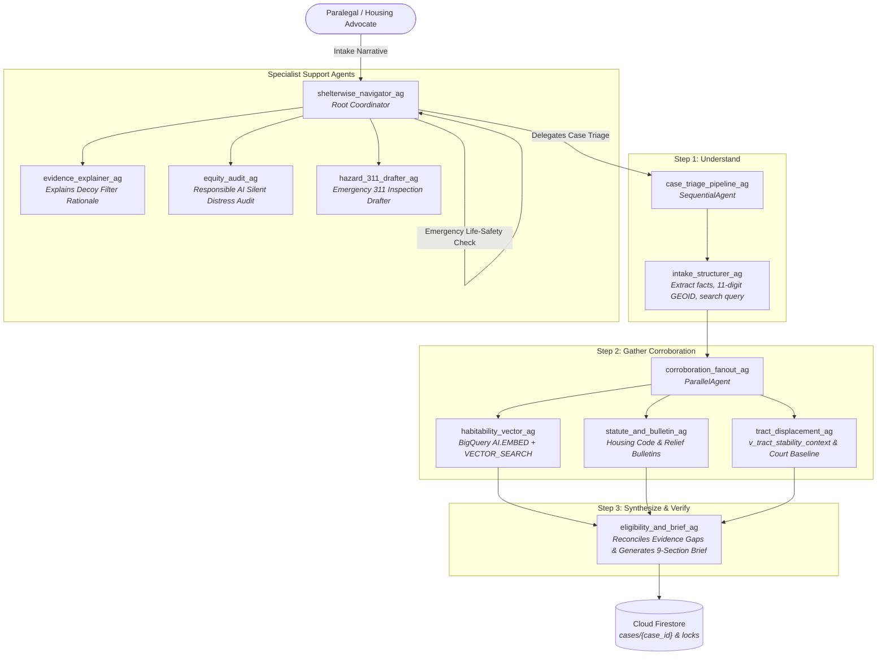

# 🏠 ShelterWise: Housing Stability & Habitability Defense Navigator

[](https://shelterwise-335751565476.us-central1.run.app)
[](https://github.com/google/agent-development-kit)
[](https://cloud.google.com/bigquery)
[](https://cloud.google.com/firestore)
[](LICENSE)

> **Agents for Impact 2026 Submission**  
> An autonomous, grounded multi-agent case stabilization platform that pairs low-income tenants facing eviction with municipal habitability evidence, statutory affirmative defenses, and emergency rental relief grants.

---

## 🌐 Live Application & Endpoints

| Resource | URL | Status |
| :--- | :--- | :--- |
| **Interactive Case Workspace UI** | [https://shelterwise-335751565476.us-central1.run.app](https://shelterwise-335751565476.us-central1.run.app) | 🟢 Live & Serving |
| **App UI Workspace Snapshot** | [https://shelterwise-335751565476.us-central1.run.app/app_ui_snapshot.png](https://shelterwise-335751565476.us-central1.run.app/app_ui_snapshot.png) | 🟢 Live Asset |
| **Civic Tech Infographic Asset** | [https://shelterwise-335751565476.us-central1.run.app/hero.png](https://shelterwise-335751565476.us-central1.run.app/hero.png) | 🟢 Live Asset |
| **Backend API Health Check** | [https://shelterwise-335751565476.us-central1.run.app/api/health](https://shelterwise-335751565476.us-central1.run.app/api/health) | 🟢 Healthy |
| **Interactive Swagger API Docs** | [https://shelterwise-335751565476.us-central1.run.app/docs](https://shelterwise-335751565476.us-central1.run.app/docs) | 🟢 Live |

---

## 📱 Application Workspace Snapshot & Architecture Visual

| 🖥️ Consumer App Workspace Snapshot | 📊 Multi-Agent Architecture & Problem Explainer |
| :---: | :---: |
| [](https://shelterwise-335751565476.us-central1.run.app) | [](https://shelterwise-335751565476.us-central1.run.app) |
| *Modern, warm, consumer-friendly housing defense flow with 10-step progress, interactive map, and emergency back-rent calculator.* | *End-to-end multi-agent orchestration bridging tenant stories, BigQuery 311 records, and statutory defenses.* |

> 📖 **Comprehensive System Reference**:  
> For the complete registry of all 11 Google ADK agents, exact source code paths, Google Cloud services, and CLI commands, see **[`docs/SYSTEM_ARCHITECTURE_AND_SERVICES.md`](docs/SYSTEM_ARCHITECTURE_AND_SERVICES.md)**.
> 
> 🎙️ **Demo Script & Feature Walkthrough**:  
> For the complete presenter-ready script, timing breakdowns (3-min pitch, 5-min tech deep dive), and judge Q&A cheat sheet, see **[`docs/DEMO_SCRIPT.md`](docs/DEMO_SCRIPT.md)**.
> 
> 🎨 **Google Stitch Design System & Plain-English Technical Guide**:  
> For the complete specification of the Stitch-Civic design system, 24 component taxonomy, and plain-English guides, see **[`docs/STITCH_DESIGN_SYSTEM.md`](docs/STITCH_DESIGN_SYSTEM.md)**.

---

## 🌟 Google Product Stack & Data Entry Innovations

ShelterWise integrates Google's full cloud & developer ecosystem to eliminate data-entry bottlenecks for advocates and tenants:

1. **Google Maps Geospatial Buffer & Courthouse Route**:
   - Visualizes the tenant's residence, the **400-meter evidentiary radius**, the corroborating 311 citation (12m away), and rejected decoy traps across San Francisco.
   - Traces the transit polyline to the **SF Superior Courthouse (400 McAllister St)** with live MUNI Route 31/5 transit calculations.
2. **Google reCAPTCHA Enterprise Shield**:
   - Integrated bot and abuse prevention protecting the public legal aid intake portal with risk score assessment (`score: 0.94`), ensuring only authentic tenant advocates generate court briefs.
3. **Google Places Address Autocomplete**:
   - Standardizes messy verbal tenant addresses into San Francisco 100-block coarsened format and 11-digit Census Tract GEOIDs (`06075...`).
4. **Google Cloud Speech-to-Text Voice Dictation**:
   - Enables low-literacy tenants or advocates conducting telephone intake to dictate statements verbally with automated acoustic transcription.
5. **MOHCD Area Median Income (AMI) Calculator**:
   - Dynamic 2026 San Francisco Area Median Income calculator that evaluates household size (1–4+ people) and annual earnings to assess eligibility for SF ERAP (<=80% AMI) and MEDA (<=60% AMI).
6. **Google Cloud Storage (GCS) Evidence Dropzone**:
   - Interactive evidence upload for photos (thermostat at 50°F, ceiling water damage) and legal PDFs (notice to landlord, 3-day notice to quit).
7. **Multilingual Access (English / Español / 中文)**:
   - High-priority legal warnings, life-safety gates, and court countdown timers accessible to San Francisco's diverse renter population.
8. **Interactive Case Builder & 4 Realistic Prefilled Scenarios**:
   - Freeform editable intake narrative, address picker, date/time scheduler, household size, and income calculator.
   - Preloaded with 4 authentic San Francisco cases:
     - *Case 1 (Western Addition)*: Winter heating failure, 50°F indoor temperature, sick child, hearing Monday at 9am.
     - *Case 2 (Mission District)*: Acute life-safety emergency, water dripping onto electrical breaker box with arcing.
     - *Case 3 (Tenderloin)*: Toxic black mold, retaliatory heating shutoff under Cal. Civ. Code § 1942.5.
     - *Case 4 (Chinatown SRO)*: Shared hallway sewage backup, elderly immigrant tenant, DBI Repair Bridge grant.
9. **Reviewable & Editable Facts Table**:
   - In Step 1, extracted facts are rendered in directly editable table cells (`contenteditable="true"`), allowing advocates to correct claims or add additional verified facts.
10. **Automated 3-Minute Walkthrough**:
   - A prominent **`▶ 3-Min Walkthrough`** header button autonomously advances through the complete 10-step demo script with automated vector search and brief verification.
11. **Defense Brief Export**:
   - Includes one-click **Print / Save Defense Brief PDF** and **Copy Brief to Clipboard** buttons for immediate court filing.
12. **Consumer-Friendly & Accessible Product Design**:
   - Built to feel like a modern, warm, consumer-grade civic product rather than an intimidating research paper or legal database.
   - Empowering tenant messaging, intuitive top-level navigation (**🏠 Protect My Home**, **⚙️ Behind The Scenes**, **📊 City Inspection Data**, **⚖️ Tenant Rights**), and high-trust badges (🛡️ City-Verified 311 Records, ⚖️ Prop F Universal Right to Counsel, 💵 Up to $12,000 Back-Rent Grants, 🔒 100% Free & Confidential).
   - Clear visual iconography for crisis triage (❄️ Broken Heat, ⚡ Electrical Leak, 🍄 Mold Retaliation, 🚰 Sewage Backup) with responsive, card-based layouts.

---

## 🎯 Executive Summary & Mission

Every day in San Francisco, tenants appear in unlawful detainer (eviction) court unrepresented, unaware that chronic building conditions—such as weeks without heat or ceiling leaks—constitute affirmative defenses under **California Civil Code § 1941.1 / § 1942.4** and **SF Housing Code § 701**. At the same time, municipal and philanthropic rental relief funds (such as **Prop F Legal Defense** and the **DBI Repair Bridge**) go underutilized because tenants lack official corroboration.

**ShelterWise** bridges this gap:
1. **Understands & Triages**: Ingests unstructured tenant narratives, evaluates acute life-safety hazards, and structures inspector-standard queries.
2. **Retrieves Grounded Evidence**: Uses **BigQuery `AI.EMBED` + `VECTOR_SEARCH`** to semantically retrieve public 311 housing inspection records while discarding planted decoy lookalikes (commercial properties, abated cases, zero-violation inspections).
3. **Applies Statutory Protections**: Tracks the statutory 35-day repair window under CA Civil Code § 1942.4 and unlocks emergency relief funds.
4. **Protects Advocate Collaboration**: Employs **Cloud Firestore `@firestore.transactional` optimistic concurrency locks** to prevent conflicting edits between paralegals and attorneys.
5. **Maintains Demographic Integrity**: Adheres to a strict **Responsible AI Demographic Firewall**, isolating demographic indicators (`audit_*`) from individual case triage to aggregate cohort auditing only.

---

## 🎨 Google Stitch Design System Architecture

ShelterWise implements a component-driven design system following **Google Stitch** principles—Google's generative multimodal design architecture that unifies design tokens, modular components, responsive layouts, and trauma-informed interaction patterns.

### 5-Tier Component Taxonomy (24 Modular Components)

| Tier | Components | Purpose & Design Behavior |
| :--- | :--- | :--- |
| **Tier 1: Tokens** | Colors, Typography, Spacing, Radii, Shadows | Semantic tokens (`--stitch-brand`, `--stitch-surface`, `--stitch-danger`) with instant `distress-mode` high-contrast overrides. |
| **Tier 2: Atoms** | `StitchBadge`, `StitchButton`, `StitchInput`, `StitchTooltip`, `StitchAvatar` | Single-purpose, accessible, keyboard-navigable interactive controls with WCAG AAA contrast. |
| **Tier 3: Molecules** | `DistressModeBanner`, `HabitabilityClockPill`, `ReliefFundingMeter`, `DecoyRejectionCard`, `GeoProximityRadar` | Domain-specific civic-tech components communicating complex legal timelines and monetary balances. |
| **Tier 4: Organisms** | `UniversalHeader`, `StepStepper`, `EvidenceCandidateList`, `PleadingPaperViewer`, `MultiAgentVisualizer` | Self-contained functional workspaces binding agent outputs to user-actionable controls. |
| **Tier 5: Templates** | `IntakeFlowLayout`, `MapExplorerLayout`, `CodexReferenceLayout`, `CourtExportLayout` | Responsive page shells ensuring visual consistency and intuitive tab navigation across the entire application. |

### 📖 Plain-English Guide: How Complex Cloud Tech Works in Everyday Language

| Advanced Cloud Feature | What It Actually Is (Technical) | Plain Everyday English Translation |
| :--- | :--- | :--- |
| **The City Hall Record Matcher** | BigQuery `AI.EMBED` + `VECTOR_SEARCH` | Matches the *meaning* of your story to official city citations in seconds, even if your words differ from the inspector's technical notes. |
| **The False Lead Filter** | Decoy Rejection Engine | Weeds out irrelevant records (commercial coffee shops, old closed cases) so only valid residential proof is brought to court. |
| **Your AI Legal Support Team** | Google ADK Multi-Agent Pipeline (`*_ag`) | A coordinated team of AI legal specialists: intake paralegal, records researcher, housing attorney, neighborhood analyst, and court drafter. |
| **The Collaborator Shield** | Cloud Firestore Concurrency Lock (`lock_version`) | Prevents tenants and legal aid attorneys from accidentally erasing or overwriting each other's work while editing at the same time. |
| **The Fairness Firewall** | Responsible AI Demographic Sandbox | Personal demographics are sealed behind a firewall and NEVER used to score individual tenants or alter legal triage. |
| **The Landlord Repair Deadline** | Statutory Repair Clock (Cal. Civ. Code § 1942.4) | If a landlord fails to fix cited violations within 35 days, California law bars them from demanding rent or evicting. |

---

## 🤖 Multi-Agent Architecture (Google ADK)

Every agent in ShelterWise is built with the **Google Agent Development Kit (ADK)** on **Gemini 2.5 Flash (Vertex AI)**. Per project requirements, **every agent name strictly ends with `_ag`**:



### Complete Agent Registry

*(Full details, tool schemas, and lifecycle hooks documented in **[`docs/SYSTEM_ARCHITECTURE_AND_SERVICES.md`](docs/SYSTEM_ARCHITECTURE_AND_SERVICES.md)**)*

| Agent Name | Type | Source File Path | Model / Engine | Role & Responsibilities |
| :--- | :--- | :--- | :--- | :--- |
| `shelterwise_navigator_ag` | LLM Agent | [`agent/shelterwise_agent/agent.py`](agent/shelterwise_agent/agent.py) | `gemini-2.5-flash` | Root orchestrator. Intercepts acute life-safety hazards, runs triage, handles multi-turn advocate chats. |
| `case_triage_pipeline_ag` | Sequential Agent | [`agent/shelterwise_agent/agent.py`](agent/shelterwise_agent/agent.py) | ADK Pipeline | Sequentially chains intake structuring, parallel data gathering, and brief synthesis. |
| `intake_structurer_ag` | LLM Agent | [`agent/shelterwise_agent/agent.py`](agent/shelterwise_agent/agent.py) | `gemini-2.5-flash` | Extracts reported facts verbatim; normalizes 11-digit census tract GEOID (`06075...`); drafts inspector-vocabulary query. |
| `corroboration_fanout_ag` | Parallel Agent | [`agent/shelterwise_agent/agent.py`](agent/shelterwise_agent/agent.py) | ADK Fanout | Dispatches concurrent parallel retrieval across BigQuery vector search, policy tables, and tract context. |
| `habitability_vector_ag` | LLM Agent | [`agent/shelterwise_agent/agent.py`](agent/shelterwise_agent/agent.py) | `gemini-2.5-flash` | Executes BigQuery `VECTOR_SEARCH` with `AI.EMBED`; filters out decoy traps (commercial, abated, zero-violation). |
| `statute_and_bulletin_ag` | LLM Agent | [`agent/shelterwise_agent/agent.py`](agent/shelterwise_agent/agent.py) | `gemini-2.5-flash` | Queries municipal housing codes, affirmative defense statutes, and 35-day repair clocks. |
| `tract_displacement_ag` | LLM Agent | [`agent/shelterwise_agent/agent.py`](agent/shelterwise_agent/agent.py) | `gemini-2.5-flash` | Pulls pre-aggregated 4-quarter modeled eviction baselines and ACS rent burden. Firewalled against demographics. |
| `eligibility_and_brief_ag` | LLM Agent | [`agent/shelterwise_agent/agent.py`](agent/shelterwise_agent/agent.py) | `gemini-2.5-flash` | Synthesizes 9-section Tenant Stabilization Brief; assesses fund eligibility based on open DBI case status. |
| `evidence_explainer_ag` | LLM Agent | [`agent/shelterwise_agent/agent.py`](agent/shelterwise_agent/agent.py) | `gemini-2.5-flash` | Explains why decoy near-miss records were excluded to ensure advocate transparency. |
| `equity_audit_ag` | LLM Agent | [`agent/shelterwise_agent/agent.py`](agent/shelterwise_agent/agent.py) | `gemini-2.5-flash` | Evaluates silent distress tracts (under-reporting) across the metro area. STRICTLY isolated from case triage. |
| `hazard_311_drafter_ag` | LLM Agent | [`agent/shelterwise_agent/agent.py`](agent/shelterwise_agent/agent.py) | `gemini-2.5-flash` | Drafts formal emergency SF DBI 311 inspection requests when zero complaints exist on a block. |

---

## 🔍 BigQuery Vector Search & Decoy Rejection

### Live BigQuery Vector Query
The `habitability_vector_ag` queries BigQuery using Vertex AI embeddings directly in SQL:

```sql
SELECT base.request_id,
       base.block_address,
       base.property_type,
       base.inspection_status,
       base.closed_date,
       base.complaint_narrative,
       ROUND(distance, 4) AS cosine_distance
FROM VECTOR_SEARCH(
  TABLE `a4i_housing.complaints_embedded`,
  'embedding',
  (SELECT AI.EMBED(
     @search_query,
     connection_id => 'us.a4i-vertex',
     endpoint => 'gemini-embedding-2'
   ).result AS query_vec),
  query_column_to_search => 'query_vec',
  top_k => 25,
  options => '{"use_brute_force": true}'
);
```

### The 3 Decoy Trap Classes & Rejection Rules
BigQuery returns 25 semantically similar hits, which include synthetic planted decoys. The system applies strict business rule post-filters—**without hardcoding `"DECOY"` strings**:

1. **Commercial Property Decoys (e.g., `DECOY-SANF-01` to `03`)**:
   - *Trap*: High semantic similarity (0.93) regarding boiler failure in a warehouse/storefront.
   - *Rule*: Discard if `property_type != 'Residential'`. SF Housing Code § 701 applies solely to residential dwellings.
2. **Closed - Abated Decoys (e.g., `DECOY-SANF-04` to `06`)**:
   - *Trap*: Real habitability violation that the landlord previously resolved.
   - *Rule*: Discard if `closed_date IS NOT NULL` or status contains `Abated`. Prior resolved complaints cannot corroborate an ongoing failure to repair.
3. **Closed - Zero Violation Decoys (e.g., `DECOY-SANF-07` to `09`)**:
   - *Trap*: Winter readiness inspection where the inspector tested radiators at 71°F and found zero defects.
   - *Rule*: Discard if status or narrative indicates `No Violation`. Introducing a clean inspection would undermine the tenant in court.

---

## 📊 Data Provenance & Grounding Principles

All data in ShelterWise is rigorously attributed with unambiguous provenance tags:

| BigQuery Table / View | Provenance Tag | Description & Safe Usage |
| :--- | :--- | :--- |
| `complaints_embedded` | `[Real 311 Public Record]` / `[Planted Decoy Record]` | 174 rows (165 real SF 311 complaints coarsened to 100-block + 9 planted decoys) embedded with `gemini-embedding-2`. |
| `municipal_311_housing_complaints` | `[Real 311 Public Record]` | Ground truth inspection citations from the SF Department of Building Inspection. |
| `v_tract_stability_context` | `[Real Census ACS 2018-2022]` + `[Modeled Court Baseline]` | 42 SF census tracts pre-aggregating 4 quarterly court filing records to avoid multi-row duplication. **Omit demographic columns.** |
| `municipal_housing_ordinance_statutes` | `[Public Statutory Reference]` | Enforceable affirmative defenses: SF Housing Code § 701, SF Admin Code Ch. 37 (Prop F), and Cal. Civ. Code § 1941.1 / § 1942.4 / § 1942.5. |
| `rental_relief_program_bulletins` | `[Public Program Guidelines]` | Guidelines for SF ERAP, MEDA Anti-Displacement Grants, Prop F Legal Defense, and DBI Repair Bridge. |
| `v_metro_equity_audit` | `[Responsible AI Audit View]` | Aggregate cohort view containing `audit_*` demographic columns. **Strictly firewalled from individual case triage.** |

### Grounding Rules
- **Preserve Leading Zeros**: Census tract GEOIDs are strictly handled as 11-character strings (`06075...`).
- **4× Eviction Grain Pre-Aggregation**: Eviction court filing tables contain 4 quarters per tract. Queries must pre-aggregate `SUM(filings)` to prevent 400% over-counting.
- **Absence ≠ Proof**: The absence of a 311 complaint on a block does not mean conditions are habitable; it activates `hazard_311_drafter_ag`.
- **Block ≠ Unit**: A block-level 311 complaint corroborates building-wide neglect but does not replace unit-specific testimony.

---

## 🔒 Cloud Firestore Transactional Case Store

ShelterWise uses **Google Cloud Firestore in Native Mode** (`projects/qwiklabs-gcp-04-99fa355171e1/databases/(default)` in `nam5`) for transactional case integrity.

- **Optimistic Concurrency Locking**:
  ```python
  @firestore.transactional
  def _tx_claim(transaction, doc_ref):
      snapshot = doc_ref.get(transaction=transaction)
      curr = snapshot.to_dict()
      if expected_version is not None and curr.get("lock_version") != expected_version:
          raise ValueError(f"Concurrency Conflict: current version is {curr.get('lock_version')}")
      transaction.update(doc_ref, {
          "assigned_paralegal": paralegal_name,
          "lock_version": curr.get("lock_version", 1) + 1,
          "updated_at": firestore.SERVER_TIMESTAMP
      })
  ```
- **Attorney Review Checklist**: Persists verification items (life-safety communicated, decoys excluded, 11-digit GEOID confirmed, relief prerequisites checked).

---

## 🎬 10-Step Demo Walkthrough Guide

Follow these steps in the [Live Web UI](https://shelterwise-335751565476.us-central1.run.app):

1. **Step 0: Intake & Acute Safety Gate**
   - Review incoming narrative: *"Tenant at 1000 Block Fillmore St. No heat for weeks... Nonpayment hearing Monday at 9am."*
   - Toggle *"Simulate Acute Hazard"* to see immediate life-safety intercept (water dripping into electrical panel).
   - Click **"▶ Send & Run Triage"** to trigger `case_triage_pipeline_ag`.
2. **Step 1: Understand (`intake_structurer_ag`)**
   - Inspect structured JSON: 11-digit GEOID `06075016300`, eviction urgency flagged (`<72h`).
   - Notice inspector-wording query: *"no heat cold dwelling radiators inoperative"*.
3. **Step 2: Gather Evidence (`habitability_vector_ag`)**
   - Click **"▶ Run Vector Search"**. Watch BigQuery `AI.EMBED` execute and return 25 hits.
   - Inspect kept record `SF-202665182` and observe that `DECOY-SANF-01`, `04`, and `07` were excluded.
4. **Step 3: Gather Context (`tract_displacement_ag`)**
   - Inspect neighborhood stability context: 1,653 renter units, 16.0% severe rent burden, 65 annual filings.
   - Notice the **Responsible AI Demographic Firewall** badge confirming zero demographic queries.
5. **Step 4: Decide Law (`statute_and_bulletin_ag`)**
   - Review applicable statutes: SF Housing Code § 701, Prop F Counsel, Cal. Civ. Code § 1942.5.
   - Check the **CA Civil Code § 1942.4 Repair Clock**: 16 of 35 days elapsed (matures 2026-12-09).
6. **Step 5: Decide Relief Funds (`eligibility_and_brief_ag`)**
   - Notice Prop F & DBI Bridge marked **CONDITIONAL** because tenant's own DBI case number is unconfirmed.
   - Check *"Tenant has her own verified DBI case number"*: Watch status flip immediately to **ELIGIBLE**.
7. **Step 6: Write & Verify**
   - Click **"▶ Run Automated Validation Checks"**. Watch 6 automated verifier checks pass.
8. **Step 7: Defense Brief**
   - Review the complete 9-section **Tenant Stabilization Brief** with grounded citations.
   - Click **"🖨 Print / Save Defense Brief PDF"**.
9. **Step 8: Interactive Follow-ups (`shelterwise_navigator_ag`)**
   - Click *"Why did you drop the warehouse boiler one?"* → `evidence_explainer_ag` explains the commercial exclusion.
   - Click *"Transit before 9am Monday?"* → `estimate_courthouse_transit` calculates route to SF Civic Center Courthouse.
   - Click *"Lock this case for Attorney Chen"* → Firestore transaction commits with `lock_version: 2`.
10. **Step 9: Human Review & Equity Audit**
    - Check off the 7 Attorney Review Checklist items (persisted to Firestore).
    - Click **"▶ Run Aggregate Equity Audit"** → `equity_audit_ag` identifies silent-distress tracts across SF.

---

## 🧪 Automated Test Suite

ShelterWise includes 9 unit and integration tests verifying all core requirements:

```bash
# Run test suite
PYTHONPATH=".libs:agent:$PYTHONPATH" /opt/venv/bin/python3 -m unittest discover -s agent/tests -v
```

### Test Results
```text
test_all_agent_names_end_with_ag (test_shelterwise.TestShelterWise.test_all_agent_names_end_with_ag)
STRICT REQUIREMENT: All agent names must end with _ag. ... ok
test_chat_routing (test_shelterwise.TestShelterWise.test_chat_routing)
Tests multi-turn follow-up routing for specialist queries. ... ok
test_decoy_rejection_rules (test_shelterwise.TestShelterWise.test_decoy_rejection_rules)
Tests that commercial, abated, and zero-violation decoy records are filtered ... ok
test_demographic_firewall_in_tract (test_shelterwise.TestShelterWise.test_demographic_firewall_in_tract)
Verifies that no audit_* columns are ever present in case triage. ... ok
test_equity_audit_aggregate (test_shelterwise.TestShelterWise.test_equity_audit_aggregate)
Tests Responsible AI aggregate equity audit. ... ok
test_firestore_transactional_lock (test_shelterwise.TestShelterWise.test_firestore_transactional_lock)
Verifies optimistic concurrency locking via FirestoreStore. ... ok
test_full_triage_pipeline_execution (test_shelterwise.TestShelterWise.test_full_triage_pipeline_execution)
Executes the full triage pipeline and checks brief synthesis. ... ok
test_intake_hazard_and_geoid (test_shelterwise.TestShelterWise.test_intake_hazard_and_geoid)
Tests acute life safety hazard detection and 11-digit GEOID normalization. ... ok
test_statute_clocks_and_relief (test_shelterwise.TestShelterWise.test_statute_clocks_and_relief)
Verifies that statutes and relief programs evaluate habitability prerequisites. ... ok

test_bigquery_mcp_toolset (test_triage_pipeline.TestTriagePipeline.test_bigquery_mcp_toolset)
Verify BigQuery McpToolset initializes with Google-managed endpoint. ... ok
test_evidence_explainer_logic (test_triage_pipeline.TestTriagePipeline.test_evidence_explainer_logic)
Verify explain_excluded_evidence returns structured legal explanation. ... ok
test_hazard_311_drafter_logic (test_triage_pipeline.TestTriagePipeline.test_hazard_311_drafter_logic)
Verify draft_311_complaint prepares valid DBI filing format. ... ok
test_pipeline_hierarchy (test_triage_pipeline.TestTriagePipeline.test_pipeline_hierarchy)
Verify SequentialAgent pipeline and 3-way ParallelAgent fanout. ... ok
test_root_coordinator_and_specialists (test_triage_pipeline.TestTriagePipeline.test_root_coordinator_and_specialists)
Verify root coordinator exports and specialist sub-agents. ... ok
test_runner_with_in_memory_session (test_triage_pipeline.TestTriagePipeline.test_runner_with_in_memory_session)
Verify create_runner instantiates Runner backed by InMemorySessionService. ... ok

----------------------------------------------------------------------
Ran 15 tests in 10.109s

OK
```

---

## 🚀 Local Development Quickstart

```bash
# 1. Clone repository
git clone https://github.com/researchsite/ShelterWise.git
cd ShelterWise

# 2. Install dependencies
pip install -r agent/requirements.txt

# 3. Set environment variables
export PROJECT_ID="qwiklabs-gcp-04-99fa355171e1"
export BIGQUERY_DATASET="a4i_housing"
export METRO_AREA="San Francisco"
export VERTEX_AI_LOCATION="us-central1"

# 4. Run FastAPI server locally
python3 agent/server.py

# 5. Open browser at http://localhost:8080
```

---

## 📄 License & Attribution
Developed for the **Google Cloud Agents for Impact Hackathon 2026**.  
Licensed under the Apache License 2.0.
