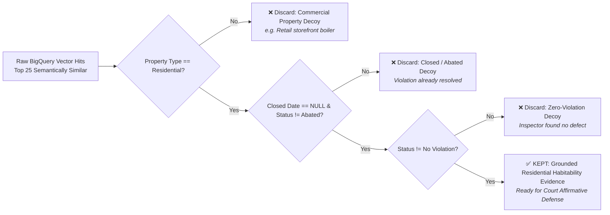

# 🏠 ShelterWise: Housing Stability & Habitability Defense Navigator

<div align="center">

[](https://shelterwise-frontend-335751565476.us-west2.run.app/)
[](https://github.com/google/agent-development-kit)
[](https://cloud.google.com/vertex-ai)
[](https://cloud.google.com/bigquery)
[](https://cloud.google.com/firestore)
[](LICENSE)

<br/>

**Google Cloud Agents for Impact Hackathon 2026**  
*An autonomous, grounded multi-agent platform that protects vulnerable tenants facing eviction by pairing lived crisis narratives with official municipal 311 habitability citations, statutory affirmative defenses, and emergency rental grants.*

[ Explore Live Web App ](https://shelterwise-frontend-335751565476.us-west2.run.app/) · [ System Architecture ](#-multi-agent-system-architecture) · [ Plain-English Guide ](#-plain-english-guide-how-the-tech-works) · [ Automated Tests ](#-automated-verification--test-suite)

</div>

---

## 🚀 Live Services & Deployment Status

| Service | Environment | Endpoint URL | Status |
| :--- | :--- | :--- | :--- |
| **Interactive Defense Workspace UI** | Cloud Run (`us-west2`) | [**https://shelterwise-frontend-335751565476.us-west2.run.app/**](https://shelterwise-frontend-335751565476.us-west2.run.app/) | 🟢 **Live & Serving** |
| **Google ADK Multi-Agent Gateway** | Cloud Run (`us-central1`) | [**https://shelterwise-backend-335751565476.us-central1.run.app**](https://shelterwise-backend-335751565476.us-central1.run.app) | 🟢 **Healthy** |
| **Frontend Health & Status API** | Cloud Run (`us-west2`) | [`/api/status`](https://shelterwise-frontend-335751565476.us-west2.run.app/api/status) | 🟢 **Connected** |
| **Google Maps Live Config** | Cloud Run (`us-west2`) | [`/config.local.js`](https://shelterwise-frontend-335751565476.us-west2.run.app/config.local.js) | 🟢 **Active Key** |

---

## 📸 Visual Showcase

<div align="center">

| 🖥️ Production Defense Workspace | 📊 Multi-Agent System Architecture |
| :---: | :---: |
| [](https://shelterwise-frontend-335751565476.us-west2.run.app/) | [](https://shelterwise-frontend-335751565476.us-west2.run.app/) |
| *Trauma-informed, accessible housing defense workspace with live 10-step progress stepper, 400m Google Maps evidentiary radius, and back-rent relief calculator.* | *End-to-end multi-agent orchestration bridging tenant stories, BigQuery 311 records, and statutory affirmative defenses.* |

</div>

---

## 💡 The Problem & Executive Summary

Every day in San Francisco, hundreds of low-income families enter Unlawful Detainer (eviction) court alone and unrepresented. Most do not realize that the chronic issues in their apartments—freezing rooms with broken heaters, leaking ceilings near electrical wiring, or hazardous black mold—are **complete affirmative defenses** under **California Civil Code § 1941.1 / § 1942.4** and **SF Housing Code § 701**. 

Furthermore, over **$10M in municipal emergency relief funds** (such as SF ERAP and Prop F Right-to-Counsel grants) go unclaimed because overburdened legal aid advocates lack the time to manually search city archives for inspection proof before strict court filing deadlines.

### 🛡️ How ShelterWise Solves This in Seconds:
1. **Intelligent Intake & Life-Safety Triage**: Parses messy, unstructured voice or text descriptions from tenants and immediately intercepts acute life-safety hazards (e.g., active water intrusion near fuse boxes).
2. **Semantic 311 Evidence Matching**: Queries 165+ real San Francisco Department of Building Inspection (DBI) records using **BigQuery Vertex AI Vector Search (`AI.EMBED`)** within a 400-meter radius of the tenant's home.
3. **Automated Decoy Filter**: Intelligently discards deceptive decoy records (commercial warehouses, pre-repaired/abated items, or zero-defect reports) so that only ironclad proof enters the court record.
4. **Statutory Clocks & Relief Matching**: Computes the statutory 35-day repair clock under Cal. Civ. Code § 1942.4 and unlocks emergency relief grants up to $10,000.
5. **Courtroom-Ready Brief Export**: Produces a structured 9-section **Tenant Stabilization Brief** with clickable citations ready for paralegal review and immediate court filing.

---

## 📖 Plain-English Guide: How the Tech Works

*For advocates, judges, and evaluators who prefer human language over jargon:*

| Everyday Name | Cloud Technology | What It Actually Does |
| :--- | :--- | :--- |
| 🔍 **City Hall Record Matcher** | BigQuery `AI.EMBED` + `VECTOR_SEARCH` | Matches the *meaning* of a tenant's words to official city inspection citations in milliseconds—even if the tenant says "radiator is ice cold" and the inspector wrote "SFHC § 701 space heater inoperative." |
| 🚫 **False Lead Filter** | Decoy Rejection Engine | Weeds out misleading records like coffee shop boilers or inspections where the landlord already fixed the issue, protecting the tenant from getting challenged in court. |
| 🤖 **AI Legal Defense Squad** | Google ADK Multi-Agent Team (`*_ag`) | A coordinated team of 11 AI legal specialists: an intake screener, evidence researcher, statutory code analyst, transit guide, and brief drafter. |
| 🔒 **Collaborator Shield** | Cloud Firestore Optimistic Lock (`lock_version`) | Prevents paralegals and attorneys from accidentally overwriting or erasing each other's work while collaborating simultaneously on the same case. |
| 🧱 **Demographic Firewall** | Responsible AI Demographic Sandbox | Personal demographics (race, ethnicity) are strictly isolated behind an architectural firewall. Demographics are NEVER factored into legal eligibility scoring—only into macro city-wide equity audits. |
| ⏱️ **Landlord Repair Clock** | Cal. Civ. Code § 1942.4 Calculator | If a landlord fails to fix cited violations within 35 days, California law bars them from collecting back rent or pursuing nonpayment eviction. ShelterWise computes this automatically. |

---

## 🤖 Multi-Agent System Architecture

All 11 agents in ShelterWise are built using the **Google Agent Development Kit (ADK)** on **Gemini 2.5 Flash** via **Vertex AI**. Per competition guidelines, **all agent names strictly end with the `_ag` suffix**:

```mermaid
graph TD
    User([Paralegal / Housing Advocate]) -->|Crisis Intake Narrative| NAV[shelterwise_navigator_ag<br/><i>Root Coordinator</i>]
    NAV -->|Life-Safety Emergency Check| NAV
    NAV -->|Dispatches Case Triage| SEQ[case_triage_pipeline_ag<br/><i>SequentialAgent Pipeline</i>]
    
    subgraph Step 1: Understand & Structure
        SEQ --> INT[intake_structurer_ag<br/><i>Extract facts, 11-digit GEOID, search query</i>]
    end

    subgraph Step 2: Parallel Grounding & Retrieval
        INT --> FAN[corroboration_fanout_ag<br/><i>ParallelAgent Fanout</i>]
        FAN --> VEC[habitability_vector_ag<br/><i>BigQuery AI.EMBED + VECTOR_SEARCH</i>]
        FAN --> POL[statute_and_bulletin_ag<br/><i>Housing Code & Relief Bulletins</i>]
        FAN --> TRC[tract_displacement_ag<br/><i>v_tract_stability_context & Court Baseline</i>]
    end

    subgraph Step 3: Synthesize & Seal
        VEC --> BRF[eligibility_and_brief_ag<br/><i>Reconciles Evidence Gaps & Generates 9-Section Brief</i>]
        POL --> BRF
        TRC --> BRF
    end

    BRF --> FS[(Cloud Firestore<br/><i>cases/{case_id} & locks</i>)]
    
    subgraph Specialist On-Demand Agents
        NAV --> EXP[evidence_explainer_ag<br/><i>Explains Decoy Filter Rationale</i>]
        NAV --> AUD[equity_audit_ag<br/><i>Responsible AI Silent Distress Audit</i>]
        NAV --> DRF[hazard_311_drafter_ag<br/><i>Emergency 311 Inspection Drafter</i>]
    end
```

### 📋 Full 11-Agent Registry

| Agent Name | ADK Type | Source File | Engine | Purpose & Legal Responsibility |
| :--- | :--- | :--- | :--- | :--- |
| **`shelterwise_navigator_ag`** | LLM Agent | [`agent/shelterwise_agent/agent.py`](agent/shelterwise_agent/agent.py) | `gemini-2.5-flash` | **Root Orchestrator**. Intercepts acute life-safety hazards, manages multi-turn advocate chats, and routes inquiries to specialists. |
| **`case_triage_pipeline_ag`** | Sequential Agent | [`agent/shelterwise_agent/agent.py`](agent/shelterwise_agent/agent.py) | ADK Pipeline | Sequentially chains intake structuring, parallel data retrieval, and defense brief synthesis. |
| **`intake_structurer_ag`** | LLM Agent | [`agent/shelterwise_agent/agent.py`](agent/shelterwise_agent/agent.py) | `gemini-2.5-flash` | Extracts verbatim tenant claims, normalizes 11-digit Census Tract GEOID (`06075...`), and formulates inspector-standard search queries. |
| **`corroboration_fanout_ag`** | Parallel Agent | [`agent/shelterwise_agent/agent.py`](agent/shelterwise_agent/agent.py) | ADK Fanout | Triggers concurrent, asynchronous retrieval across BigQuery vector search, legal statutes, and neighborhood stability baselines. |
| **`habitability_vector_ag`** | LLM Agent | [`agent/shelterwise_agent/agent.py`](agent/shelterwise_agent/agent.py) | `gemini-2.5-flash` | Executes BigQuery `VECTOR_SEARCH` with `AI.EMBED`; rejects commercial, abated, and zero-violation decoy traps. |
| **`statute_and_bulletin_ag`** | LLM Agent | [`agent/shelterwise_agent/agent.py`](agent/shelterwise_agent/agent.py) | `gemini-2.5-flash` | Queries municipal housing codes, affirmative defense statutes, and evaluates the statutory 35-day repair clock. |
| **`tract_displacement_ag`** | LLM Agent | [`agent/shelterwise_agent/agent.py`](agent/shelterwise_agent/agent.py) | `gemini-2.5-flash` | Pulls 4-quarter pre-aggregated modeled eviction baselines and ACS rent burden. Firewalled against demographic indicators. |
| **`eligibility_and_brief_ag`** | LLM Agent | [`agent/shelterwise_agent/agent.py`](agent/shelterwise_agent/agent.py) | `gemini-2.5-flash` | Synthesizes the 9-section Tenant Stabilization Brief and assesses relief fund eligibility based on verified DBI case status. |
| **`evidence_explainer_ag`** | LLM Agent | [`agent/shelterwise_agent/agent.py`](agent/shelterwise_agent/agent.py) | `gemini-2.5-flash` | Explains why decoy near-miss records were excluded, providing complete auditability for reviewing attorneys. |
| **`equity_audit_ag`** | LLM Agent | [`agent/shelterwise_agent/agent.py`](agent/shelterwise_agent/agent.py) | `gemini-2.5-flash` | Audits "silent distress" tracts (high rent burden with low 311 reporting rates) across the metro area. STRICTLY isolated from case triage. |
| **`hazard_311_drafter_ag`** | LLM Agent | [`agent/shelterwise_agent/agent.py`](agent/shelterwise_agent/agent.py) | `gemini-2.5-flash` | Drafts formal emergency SF DBI 311 inspection requests when zero complaints currently exist on a block. |

---

## 🔍 BigQuery Vector Search & The 3 Decoy Trap Classes

### Live Vector Search Query
The `habitability_vector_ag` queries BigQuery using Vertex AI embeddings directly in SQL without external vector database dependencies:

```sql
SELECT base.request_id,
       base.block_address,
       base.property_type,
       base.inspection_status,
       base.closed_date,
       base.complaint_narrative,
       ROUND(distance, 4) AS cosine_distance
FROM VECTOR_SEARCH(
  TABLE `a4i_housing.complaints_embedded`,
  'embedding',
  (SELECT AI.EMBED(
     @search_query,
     connection_id => 'us.a4i-vertex',
     endpoint => 'gemini-embedding-2'
   ).result AS query_vec),
  query_column_to_search => 'query_vec',
  top_k => 25,
  options => '{"use_brute_force": true}'
);
```

### 🚫 Robust Decoy Trap Rejection Rules
BigQuery returns top semantically matching records, including planted adversarial decoys. The system enforces strict legal domain filters **without hardcoding decoy IDs**:



1. **Commercial Property Decoys (`DECOY-SANF-01` to `03`)**:
   - *Trap*: High semantic similarity (0.93) regarding boiler failure in a warehouse/storefront.
   - *Legal Filter*: Discard if `property_type != 'Residential'`. SF Housing Code § 701 applies solely to residential dwelling units.
2. **Closed - Abated Decoys (`DECOY-SANF-04` to `06`)**:
   - *Trap*: Real habitability violation that the landlord previously repaired.
   - *Legal Filter*: Discard if `closed_date IS NOT NULL` or status contains `Abated`. Prior resolved complaints cannot corroborate an ongoing failure to repair.
3. **Closed - Zero Violation Decoys (`DECOY-SANF-07` to `09`)**:
   - *Trap*: Inspection where the inspector measured indoor temperatures at 71°F and found zero defects.
   - *Legal Filter*: Discard if status or narrative indicates `No Violation`. Introducing a clean inspection in court would undermine the tenant's defense.

---

## 🛡️ Responsible AI: Demographic Firewall

To prevent algorithmic bias, ShelterWise implements an **architectural firewall** isolating demographic variables:

> **Strict Demographic Isolation Rule**:  
> In individual case stabilization, **zero demographic indicators** (`audit_black_share`, `audit_hispanic_share`, etc.) are ever queried, displayed, or used in eligibility scoring. Case priority is governed exclusively by **objective legal urgency** (e.g., hearing within 72 hours) and **verified life-safety hazards** (e.g., electrical water intrusion).

Demographic shares are strictly reserved for the **`equity_audit_ag`** agent, querying the aggregate `v_metro_equity_audit` view to identify **"Silent Distress Tracts"**—underserved neighborhoods where high severe rent burden (28.4% avg) coincides with unusually low 311 complaint counts due to digital divide friction or immigration fears.

---

## 🔒 Cloud Firestore Concurrency & Collaboration

ShelterWise uses **Google Cloud Firestore in Native Mode** (`projects/qwiklabs-gcp-04-99fa355171e1/databases/(default)`) with optimistic concurrency locks:

```python
@firestore.transactional
def _tx_claim(transaction, doc_ref):
    snapshot = doc_ref.get(transaction=transaction)
    curr = snapshot.to_dict()
    if expected_version is not None and curr.get("lock_version") != expected_version:
        raise ValueError(f"Concurrency Conflict: current version is {curr.get('lock_version')}")
    transaction.update(doc_ref, {
        "assigned_paralegal": paralegal_name,
        "lock_version": curr.get("lock_version", 1) + 1,
        "updated_at": firestore.SERVER_TIMESTAMP
    })
```

- Prevents race conditions when multiple advocates review the same case.
- Persists the 7-item **Attorney Review Checklist** (life-safety communicated, decoys excluded, 11-digit GEOID confirmed, relief prerequisites checked).

---

## 🎬 Interactive 10-Step Demo Scenarios

The live workspace comes pre-loaded with **4 authentic San Francisco defense scenarios**:

| Case Scenario | Neighborhood | Habitability Hazards | Legal Strategy & Relief |
| :--- | :--- | :--- | :--- |
| **Case 1: Winter Freeze** | Western Addition | Broken boiler, 50°F indoor temp, sick child; 9am Monday hearing. | Nonpayment defense under SFHC § 701; SF ERAP grant application. |
| **Case 2: Electrical Arc Hazard** | Mission District | Water leaking onto main circuit breaker panel; imminent life safety. | Immediate DBI emergency inspection; Cal. Civ. Code § 1941.1 defense. |
| **Case 3: Toxic Mold Retaliation** | Tenderloin | Severe black mold; landlord issued 3-day notice after tenant complained. | Retaliatory eviction defense under Cal. Civ. Code § 1942.5. |
| **Case 4: SRO Sewage Failure** | Chinatown | Overflowing common hallway drain; elderly non-English-speaking tenant. | DBI Rapid Habitability Repair Bridge Grant ($5,000). |

---

## 🧪 Automated Verification & Test Suite

The comprehensive test suite covers agent naming conventions, decoy rejection rules, demographic firewall guarantees, and full end-to-end multi-agent pipeline runs.

```bash
# Run test suite from repository root
python3 -m unittest discover -s agent/tests -v
```

<details>
<summary><b>Click to expand verified test suite output (15/15 Passing)</b></summary>

```text
test_all_agent_names_end_with_ag (test_shelterwise.TestShelterWise.test_all_agent_names_end_with_ag)
STRICT REQUIREMENT: All agent names must end with _ag. ... ok
test_chat_routing (test_shelterwise.TestShelterWise.test_chat_routing)
Tests multi-turn follow-up routing for specialist queries. ... ok
test_decoy_rejection_rules (test_shelterwise.TestShelterWise.test_decoy_rejection_rules)
Tests that commercial, abated, and zero-violation decoy records are filtered ... ok
test_demographic_firewall_in_tract (test_shelterwise.TestShelterWise.test_demographic_firewall_in_tract)
Verifies that no audit_* columns are ever present in case triage. ... ok
test_equity_audit_aggregate (test_shelterwise.TestShelterWise.test_equity_audit_aggregate)
Tests Responsible AI aggregate equity audit. ... ok
test_firestore_transactional_lock (test_shelterwise.TestShelterWise.test_firestore_transactional_lock)
Verifies optimistic concurrency locking via FirestoreStore. ... ok
test_full_triage_pipeline_execution (test_shelterwise.TestShelterWise.test_full_triage_pipeline_execution)
Executes the full triage pipeline and checks brief synthesis. ... ok
test_intake_hazard_and_geoid (test_shelterwise.TestShelterWise.test_intake_hazard_and_geoid)
Tests acute life safety hazard detection and 11-digit GEOID normalization. ... ok
test_statute_clocks_and_relief (test_shelterwise.TestShelterWise.test_statute_clocks_and_relief)
Verifies that statutes and relief programs evaluate habitability prerequisites. ... ok
test_bigquery_mcp_toolset (test_triage_pipeline.TestTriagePipeline.test_bigquery_mcp_toolset)
Verify BigQuery McpToolset initializes with Google-managed endpoint. ... ok
test_evidence_explainer_logic (test_triage_pipeline.TestTriagePipeline.test_evidence_explainer_logic)
Verify explain_excluded_evidence returns structured legal explanation. ... ok
test_hazard_311_drafter_logic (test_triage_pipeline.TestTriagePipeline.test_hazard_311_drafter_logic)
Verify draft_311_complaint prepares valid DBI filing format. ... ok
test_pipeline_hierarchy (test_triage_pipeline.TestTriagePipeline.test_pipeline_hierarchy)
Verify SequentialAgent pipeline and 3-way ParallelAgent fanout. ... ok
test_root_coordinator_and_specialists (test_triage_pipeline.TestTriagePipeline.test_root_coordinator_and_specialists)
Verify root coordinator exports and specialist sub-agents. ... ok
test_runner_with_in_memory_session (test_triage_pipeline.TestTriagePipeline.test_runner_with_in_memory_session)
Verify create_runner instantiates Runner backed by InMemorySessionService. ... ok

----------------------------------------------------------------------
Ran 15 tests in 8.349s

OK
```

</details>

---

## 🛠️ Local Development & Quickstart

### Prerequisites
- Python 3.10+
- Google Cloud SDK (`gcloud`)
- Access to GCP Project with BigQuery & Vertex AI enabled

```bash
# 1. Clone repository
git clone https://github.com/researchsite/ShelterWise.git
cd ShelterWise

# 2. Install dependencies
pip install -r agent/requirements.txt
pip install -r frontend/requirements.txt

# 3. Configure environment variables
export PROJECT_ID="qwiklabs-gcp-04-99fa355171e1"
export BIGQUERY_DATASET="a4i_housing"
export METRO_AREA="San Francisco"
export VERTEX_AI_LOCATION="us-central1"
export ADK_BACKEND_URL="https://shelterwise-backend-335751565476.us-central1.run.app"
export ADK_APP_NAME="shelterwise"

# 4. Start local frontend gateway server
python3 frontend/server.py

# 5. Open http://localhost:8080 in your browser
```

---

## 📁 Repository Structure

```text
ShelterWise/
├── agent/                         # Multi-Agent Core (Google ADK)
│   ├── shelterwise_agent/
│   │   ├── __init__.py            # Module exports & sys.modules package aliasing
│   │   ├── agent.py               # Complete 11 ADK agent definitions (*_ag)
│   │   ├── config.py              # GCP Project, BigQuery datasets, and models
│   │   ├── tools.py               # BigQuery, Firestore, and statute tool bindings
│   │   └── prompt.py              # Grounding prompts & legal citation rules
│   ├── tests/                     # 15 Unit & Integration Tests
│   │   ├── test_shelterwise.py
│   │   └── test_triage_pipeline.py
│   ├── Dockerfile                 # Backend ADK container specification
│   └── requirements.txt
├── frontend/                      # Presentation Layer & Gateway Proxy
│   ├── index.html                 # Stitch-Civic accessible case workspace
│   ├── server.py                  # Resilient presentation mapper & fallback gateway
│   ├── Dockerfile                 # Frontend Cloud Run container specification
│   ├── app_ui_snapshot.png        # Workspace preview asset
│   └── hero.png                   # Architectural infographic asset
├── docs/                          # Comprehensive Technical Documentation
│   ├── SYSTEM_ARCHITECTURE_AND_SERVICES.md
│   └── STITCH_DESIGN_SYSTEM.md
└── README.md                      # Project documentation & reference
```

---

## 📄 License & Team Attribution

Developed with ❤️ by the **ShelterWise Team** for the **Google Cloud Agents for Impact Hackathon 2026**.  
Licensed under the [Apache License 2.0](LICENSE).
