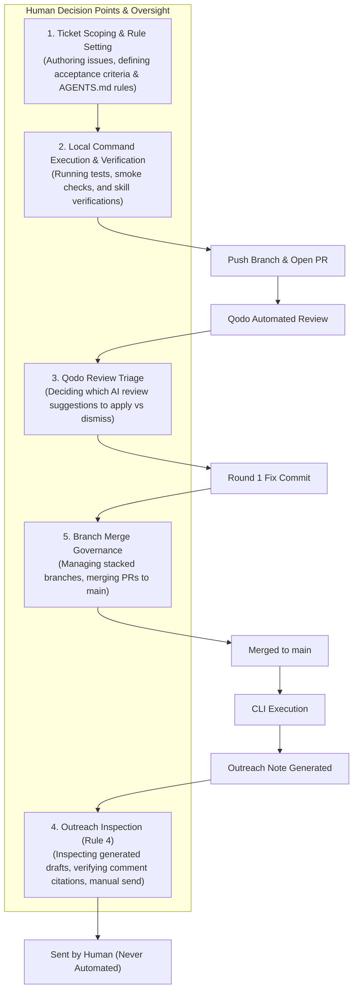
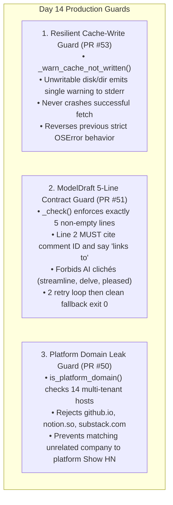

# HN Radar Architecture Review & Ground Truth Audit

**Audit Date:** November 20, 2026  
**Audited Against:** Live Codebase (`src/hnradar/`), Git History (`researchsite/hn-radar`), and GitHub Issues / Pull Requests  
**Repository Branch:** `adhocsham` on `researchsite/ShelterWise`

---

## 1. Executive Summary

A comprehensive line-by-line audit of the existing architecture documentation and diagrams was conducted against the physical implementation in `src/hnradar/` and the GitHub repository records. While the core data pipelines (HN ingestion, GitHub profile fingerprinting, Algolia search, and LLM drafting) are structurally accurate, the previous documentation contained five material inaccuracies and omitted several foundational operational realities.

This document records the exact findings, presents the full audit table, documents the missing architecture layers, and establishes the authoritative ground truth for all subsequent documentation and diagrams.

---

## 2. Full Comparative Audit Table

| # | Architecture Dimension | Previous Documentation Claim | Ground Truth (Code & GitHub) | Impact / Resolution |
|---|---|---|---|---|
| **1** | **Top Matches Count** | Stated `hnradar match` calculates and returns the "Top 10 matches" (`heapq.nlargest(10)`). | In `src/hnradar/match.py` (L77), `TOP_MATCHES = 3`. `match` returns the **top 3** scored jobs. The **10** belongs exclusively to `hnradar draft` (`DRAFT_MATCHES = 10` in `src/hnradar/cli.py` L357), which scans up to 10 candidates to find one meeting all 4 outreach criteria. | Fixed in diagrams and docs: `match` = top 3, `draft` = scans top 10. |
| **2** | **PRs #34 & #36** | Described as production features: "fallback search" and "search coordinator structure". | PR #34 and #36 were **Day 11 Seeded-Defect Experiments** (`do not merge`). They deliberately introduced subtle search degradations to test whether Qodo PR review would catch them. Both were closed unmerged as designed. | Reclassified in timeline and PR registry as Day 11 Review Experiments. |
| **3** | **"Autonomous" Pipeline** | Described an "Autonomous Engineering Factory" where Goose workers autonomously pull, implement, and PR tickets. | The Goose worker (`scripts/agent-poll.ps1` + `.goose/recipes/ticket-worker.yaml`) ran on **exactly one ticket** (Issue #5 / PR #9). Every subsequent ticket was built by hand by the developer pair-programming with Claude Sonnet, running commands manually. | Replaced "Autonomous Factory" with "Developer + AI Pair Programming with Automated Qodo Review Quality Gate". |
| **4** | **PR #43 Branch Target** | Implied PR #43 merged into `main`. | PR #43 (`feat: careers-only full-text search with Pagefind index`) merged into the **stacked branch `feat/site-careers`**, *not* `main`. PR #42 (`feat/site-careers`) and PR #44 (`feat/careers-company`) remain **open**. | Updated architecture to document the stacked branch workflow for the Careers static site. |
| **5** | **PR #1 Qodo Status** | Stated Qodo had an error on PR #1. | Qodo did not encounter an error. The user's Qodo account access was **blocked until November 11, 2026**. Once unblocked on Nov 11, `/agentic_review` ran successfully and Qodo reviewed the PR. | Clarified timeline: account access gate until Nov 11, followed by clean Qodo reviews. |
| **6** | **Human Decision Points** | Omitted from dataflow and sequence diagrams. | Critical human gates exist: (a) ticket selection, (b) command execution, (c) Qodo suggestion triage, (d) Rule 4 manual outreach review before sending, (e) PR approvals. | Added dedicated Human Decision Points section and swimlanes. |
| **7** | **Qodo Chronological Layers** | Presented as a static, pre-existing tool. | Qodo was introduced incrementally across 14 days: basic review (Nov 11) → poller hardening (Nov 12) → DoD quality gate (Nov 14) → review standards (Nov 17) → real-data skills (Nov 18) → round 1 remediation (Nov 19). | Documented progressive Qodo layering timeline. |
| **8** | **Day 14 Workflow & Guards** | Missing from architecture overview. | Day 14 (Nov 19) introduced key production guards: the resilient cache-write guard (PR #53), ModelDraft 5-line contract guard (PR #51), and platform domain filter (PR #50). | Added Day 14 Workflow & System Guards architecture. |
| **9** | **Careers Static Site** | Missing from system diagrams. | `site/careers/` contains a full static job portal with independent Pagefind 1.6.0 full-text search, brand design tokens, and XSS sanitization rules. | Added Careers Site architectural component. |
| **10** | **Works Now vs Planned Split** | Blended merged features, stacked branches, and future ideas together without status. | No visual distinction existed between production code on `main`, open branch stacks, and future roadmap tickets. | Added explicit "Works Now / Planned" status matrix. |

---

## 3. Deep-Dive on Specific Discrepancies

### 3.1. Top Matches: `match` (Top 3) vs `draft` (Top 10)

In `src/hnradar/match.py`:
```python
TOP_MATCHES = 3

def top_matches(profile: Profile, jobs: Iterable[Job], limit: int = TOP_MATCHES) -> list[Match]:
    """Best first; ties go to the newer post (higher comment_id). Fewer than `limit` is fine, and an
    empty list means "no strong matches" - never a filler top 3."""
    scored = (m for m in (score_job(profile, job) for job in jobs) if m)
    best = heapq.nlargest(limit, scored, key=lambda m: (m.score, m.job.comment_id))
    return [m.model_copy(update={"rank": i}) for i, m in enumerate(best, start=1)]
```

In `src/hnradar/cli.py`:
```python
DRAFT_MATCHES = 10

@app.command()
def draft(...):
    matches = top_matches(profile, jobs, limit=DRAFT_MATCHES + 1)
    cut = len(matches) > DRAFT_MATCHES
    for m in matches[:DRAFT_MATCHES]:
        # Evaluates candidates in order until all 4 criteria match
```

- **`hnradar match`** is an inspection tool designed for rapid developer consumption: it presents exactly the top 3 best opportunities.
- **`hnradar draft`** is an automated pipeline that needs broader search depth: it requests 11 matches, evaluates up to the top 10, and reports whether lower-ranked matches were cut.

---

### 3.2. PR #34 & #36: Day 11 Seeded-Defect Experiments

On Day 11 of the Qodo Hackathon (Nov 17), the repository participated in the **review-setup challenge**:
- **PR #35** established the durable standard in `AGENTS.md` (Rule 9: a domain match is never company ownership).
- **PR #34** (`experiment: showhn fallback and labels (Day 11, do not merge)`) deliberately injected a fallback bug where failed domain queries silently returned name search results with misleading labels.
- **PR #36** (`experiment: showhn domain search (Day 11 run B, do not merge)`) tested a second seeded variation.

Both PRs were explicitly marked *"Not for merge; it will be closed unmerged"* and served as empirical test cases to evaluate Qodo's detection threshold for subtle behavioral regressions.

---

### 3.3. The "Autonomous" Reality: Goose Worker vs Developer-Led Workflow

The term "Autonomous Engineering Factory" in previous diagrams gave the impression of an unassisted background agent fleet. The commit log and issue records reveal the true workflow:
1. **The Goose Experiment (Day 4):** Goose (`ticket-worker.yaml`) was connected to `scripts/agent-poll.ps1` to poll GitHub issues labeled `ready-for-agent`. It was executed on **exactly one issue**: Issue #5 (`Add JSON stdout output to fetch-hiring`), resulting in PR #9.
2. **The Actual Production Engine:** Every single ticket before and after PR #9 (Issues #1-#4, #6-#8, #10-#53) was built by hand: the human developer (Sham) paired with Claude Sonnet, ran tests locally (`uv run pytest`), committed code, pushed branches, and opened PRs.
3. **The True Automation:** Automated tooling was concentrated in the **review phase (Qodo Code Review bot)** and the **verification phase (`verify-jobs-parse` real-data skill)**.

---

### 3.4. PR #43 & The Careers Site Stacked Branches

PR #43 (`feat: careers-only full-text search with its own Pagefind index`) did **not** merge into `main`. It merged into `feat/site-careers` on Nov 19.

The careers site is structured as a 3-tier branch stack:
```
main (production CLI & engine)
  │
  └── feat/site-careers (PR #42 - OPEN: Static careers web pages under site/careers/)
        │
        ├── feat/careers-search (PR #43 - MERGED into feat/site-careers: Pagefind 1.6.0 indexer)
        │
        └── feat/careers-company (PR #44 - OPEN: Company detail page first slice)
```
None of this frontend code touches `main` yet, pending completion and review of the branch stack.

---

### 3.5. PR #1 History: Access Blocked Until 11 Nov

PR #1 (`feat: add hnradar fetch-hiring command`) was opened on November 8, 2026. Qodo reviews did not appear initially not because of a tool failure or error, but because the developer's Qodo account access had not yet been provisioned for the hackathon. 

Access was unblocked on **November 11, 2026**. The developer immediately triggered `/agentic_review`, Qodo delivered its review comments cleanly, and PR #1 was merged on November 12.

---

## 4. The Missing Architectural Layers

### 4.1. Human Decision Points & Gating Map

In a production AI-assisted software system, human gates are as architectural as database schemas. HN Radar relies on five non-negotiable human decision gates:



- **Rule 4 Gate:** `hnradar draft` explicitly forbids automated email or message transmission. The CLI prints the note and the source comment evidence; the human must read, verify, and transmit.
- **Review Triage Gate:** Qodo findings are not auto-applied. The developer evaluates each finding (e.g. Qodo finding on PR #53 regarding broken stderr handling), writes targeted tests, and commits fixes.

---

### 4.2. Progressive Qodo Layering (Chronological Evolution)

Qodo was not deployed as an all-or-nothing system; it evolved across 6 distinct phases:

1. **Phase 1: Entry & Account Activation (Nov 11, PR #1, #2, #7):** Account unblocked. Enabled `/review` and `/agentic_review` on core PRs.
2. **Phase 2: Infrastructure Hardening (Nov 12, PR #8):** Qodo review identified security and branch isolation vulnerabilities in `agent-poll.ps1` (worktree validation, uncommitted change retention).
3. **Phase 3: Formal Quality Gate & DoD (Nov 14, PR #22):** Integrated `docs/quality-gate.md` and Definition of Done checklist into PR review expectations.
4. **Phase 4: Review Standards Integration (Nov 16-17, PR #28, #35, #39):** Converted `AGENTS.md` rules directly into Qodo Review Standards:
   - Rule 9: Domain match is never company ownership (PR #35).
   - Rule 10: Failed upstream requests are never returned as complete (PR #39).
   - Pre-review 9-item checklist added to `AGENTS.md` (PR #28).
5. **Phase 5: Real-Data Skill & Quality Gate Armor (Nov 18, PR #48):** Introduced `.claude/skills/verify-jobs-parse/` to verify real thread changes. Qodo review hardened the skill to prevent false PASS results.
6. **Phase 6: Multi-Round Remediation Armor (Nov 19, PR #49, #50, #51, #53):** Standardized the "Review Round 1" pattern (`fix: ... review round 1`) across sentiment pulse, platform domain filtering, outreach draft generation, and resilient cache writes.

---

### 4.3. Day 14 Workflow & System Guards (Nov 19)

Day 14 represented the final stabilization sprint. Three critical architectural guards were engineered and hardened:



---

### 4.4. The Careers Static Site (`site/careers/`)

The Careers portal is an entirely decoupled static frontend residing in `site/careers/`:
- **Data Source:** Consumes `data/jobs.json` produced by `hnradar fetch-hiring`.
- **Search Engine:** Builds an independent **Pagefind 1.6.0** index (`site/tools/build_careers_index.py`) stored in `careers/pagefind/`. Runs completely isolated from any parent site search.
- **Design Tokens:** Strictly implements the `--rw-*` design token palette (`--rw-text`, `--rw-orange`, `--rw-card`) supporting instantaneous light/dark themes.
- **XSS & Content Security:** Hacker News content is rendered strictly via `textContent` after stripping bidirectional and control characters; `innerHTML` is banned.
- **Deployment Pathway:** Maintained in the `feat/site-careers` branch stack, designed for zero-build static publishing to `rawweights.com/careers/`.

---

## 5. "Works Now" vs "Planned / In-Progress" Status Matrix

| Subsystem / Feature | Current State | Code Location | Governing Rules / PRs |
|---|---|---|---|
| **Hiring Thread Ingestion** | **WORKS NOW** | `src/hnradar/sources/hn.py`, `parse.py` | PR #1, #46, #53; Rules 4, 10 |
| **Poster Reply Closed Job Filter** | **WORKS NOW** | `src/hnradar/closed.py` | PR #30; Rule 8 |
| **Resilient Cache Write** | **WORKS NOW** | `src/hnradar/sources/hn.py` | PR #53 (Issue #52); Rule 10 |
| **Candidate Profile Skip** | **WORKS NOW** | `src/hnradar/parse.py` (`is_candidate_profile`) | PR #46 (Issue #45) |
| **GitHub Developer Fingerprint** | **WORKS NOW** | `src/hnradar/sources/github.py`, `fingerprint.py` | PR #6; Rule 5 (no resume scraping) |
| **Job Matching Engine (Top 3)** | **WORKS NOW** | `src/hnradar/match.py` (`top_matches`) | PR #11; Deterministic scoring |
| **Show HN Dual-Search & Domain Check** | **WORKS NOW** | `src/hnradar/showhn.py` | PR #33, #50; Rules 9, 10 |
| **Platform Domain Filter** | **WORKS NOW** | `src/hnradar/showhn.py` (`is_platform_domain`) | PR #50 (Issue #38); Rule 9 |
| **Show HN Sentiment Pulse** | **WORKS NOW** | `src/hnradar/pulse/` | PR #49 (Issue #13); Rule 7 |
| **5-Line Outreach Draft (Top 10)** | **WORKS NOW** | `src/hnradar/draft/` | PR #51 (Issue #14); Rules 1, 2, 4 |
| **Parser Regression Skill** | **WORKS NOW** | `.claude/skills/verify-jobs-parse/` | PR #48; Quality Gate |
| **Careers Web Pages (Static)** | **IN PROGRESS (Branch Stack)** | `site/careers/` (on branch `feat/site-careers`) | PR #42 (OPEN against `main`) |
| **Careers Pagefind Search Index** | **IN PROGRESS (Branch Stack)** | `site/tools/build_careers_index.py` | PR #43 (MERGED into `feat/site-careers`) |
| **Company Detail Pages** | **IN PROGRESS (Branch Stack)** | `site/careers/company.html` | PR #44 (OPEN against `feat/site-careers`) |
| **Pre-Flight URL Reputation Checker** | **PLANNED (Issue #27)** | Not yet started | Issue #27 (Open); Rule 4 |
| **Autonomous Multi-Agent Fleet** | **HISTORICAL EXPERIMENT** | `scripts/agent-poll.ps1` (ran on PR #9 only) | Manual pair-programming remains current engine |

---

## 6. Summary of Required Updates Across Workspace Files

1. **`hn_radar_architecture_diagram.md`**:
   - Update Diagram 1 (Overall System) to distinguish `match` (top 3) from `draft` (top 10), add the Careers Site layer, and replace "Autonomous Factory" with the Human + Qodo review engine.
   - Update Diagram 3 (Matching) to display `limit=3` for `match` and `limit=10` for `draft`.
   - Update Diagram 6 (Lifecycle) to reflect the true human pair-programming + Qodo review cycle.
   - Reclassify PR #34 and PR #36 as Day 11 experiments in the PR table.
   - Clarify PR #43 merged into `feat/site-careers` (stacked branch).
   - Document PR #1 access gate (unblocked Nov 11).
   - Add the Works Now vs Planned matrix.

2. **`hn_radar_architecture.html`**:
   - Update navigation and badges with a prominent **"Works Now vs Planned"** filter.
   - Update `componentsData` descriptions for `match`, `draft`, `Goose`, and `Careers`.
   - Update `prDetailsData` for PR #1, #34, #36, and #43.
   - Add a dedicated **Human Decision Points & Day 14 Guards** panel.
   - Ensure all 6 Mermaid diagrams in the Deep Dives tab reflect these corrections.

3. **`hn_radar_user_document.md`**:
   - Correct command documentation for `hnradar match` (top 3) and `hnradar draft` (top 10 evaluation).
   - Document Rule 4 human review requirement before sending.
   - Add the Careers static site reference.
