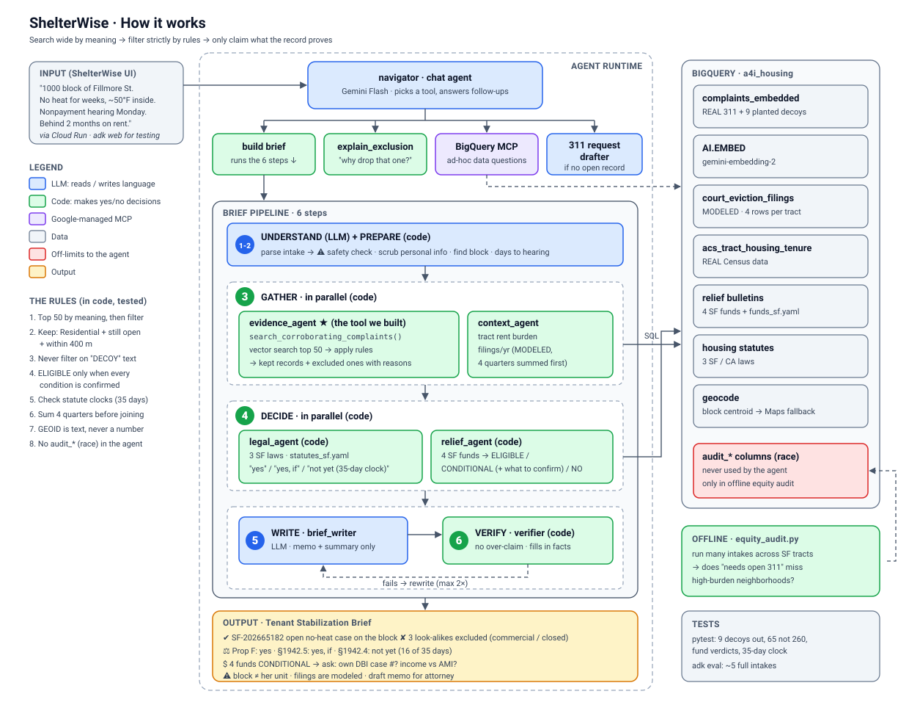

# ShelterWise — Architecture

**Owner:** Hualin · **Scope:** San Francisco · Track "Today at intake" · Python + Google ADK · Agent Runtime



---

## 1. The problem in one paragraph

A tenant walks into legal aid with an eviction hearing in a few days and a unit with no heat. If the city already has an **open** housing complaint about that block, the tenant may have legal defenses and access to emergency funds. Today nobody connects the city's 311 records to the court case before the hearing.

**ShelterWise does that link-up in about a minute:** the paralegal describes the case in plain words, and the agent returns a brief the attorney can act on.

## 2. The core problem (what is actually hard)

Finding records is the easy part. **The hard part is not over-claiming.** There are three traps:

| # | Trap | Example | Our answer |
|---|---|---|---|
| 1 | **Different words, same problem** | Tenant: "radiators stone cold". City record: "inadequate heating below code minimum" | **Vector search** (`AI.EMBED` + `VECTOR_SEARCH`) matches by meaning, not by keyword |
| 2 | **Look-alike records that don't count** | "Boiler shutdown, no heat… *commercial warehouse*", or "broken boiler… *landlord replaced it, case closed*" | After the search, **hard rules in code** keep only `Residential` + still open (`closed_date IS NULL`). Each dropped record keeps its reason |
| 3 | **Saying more than the evidence proves** | A complaint on the same block ≠ proof about *this* apartment. Modeled filing counts ≠ a real court docket. A statute with a 35-day clock may not apply yet | Funds get **ELIGIBLE / CONDITIONAL / INELIGIBLE**, statutes get "applies / not yet", and a **verifier** blocks any brief that overstates |

> In one sentence: **search wide by meaning, then filter strictly by rules, then only claim what the record proves.**

---

## 3. End-to-end sample

### 3a. Input: what the paralegal types (in `adk web`)

```text
Tenant at the 1000 block of Fillmore St. No heat for weeks, she says it's about
50 degrees inside and her kid keeps getting sick. Nonpayment hearing Monday
Nov 23 at 9am. Single mom, behind about two months on rent. What do we have?
```

*(Intake date: Thursday 2026-11-19, so the hearing is 4 days away.)*

### 3b. What the agent extracts first (`state.intake`)

```json
{
  "address_text": "1000 Block Fillmore St",
  "lat": 37.77907, "lng": -122.43185,
  "hazards": ["heat"],
  "search_query": "no heat in residential dwelling unit, indoor temperature below code minimum",
  "hearing_date": "2026-11-23",
  "days_to_hearing": 4,
  "tenant_has_own_dbi_case": null,
  "household_income_pct_ami": null
}
```

### 3c. Output: the Tenant Stabilization Brief

The paralegal sees this as a chat reply. The same content is stored as JSON in `state.brief`.
*The records, laws, funds and tract numbers below are real SF data. Which decoys rank highest is illustrative until the embeddings are built.*

```markdown
## Tenant Stabilization Brief: 1000 Block Fillmore St (hearing in 4 days)

### 1. City records that support the tenant
| Request ID    | Block                  | Status                 | Opened     | Match  |
|---------------|------------------------|------------------------|------------|--------|
| SF-202665182  | 1000 Block Fillmore St | Open - Active DBI Case | 2026-11-03 | strong |
> "...resident has been without heat... it's 52 degrees in the dwelling unit."

**Excluded look-alikes (similar text, but they don't count):**
- DECOY-SANF-01: "no heat, ceiling leak… commercial retail warehouse" → *commercial property*
- DECOY-SANF-04: "broken central boiler, freezing rooms" → *closed: landlord fixed it*
- DECOY-SANF-07: "winter readiness inspection… boiler at 71F" → *closed: no violation found*

### 2. Laws
| Citation | Applies? | Why |
|---|---|---|
| SF Admin. Code Ch. 37 & Prop F | **Yes** | Just-cause protection + city-funded lawyer for eviction cases |
| Cal. Civ. Code § 1942.5 (anti-retaliation) | **Yes, if** the tenant herself complained to the city | 180-day protection after a complaint |
| Cal. Civ. Code § 1941.1 & § 1942.4 (rent-demand bar) | **Not yet** | The violation must stay unfixed **more than 35 days**; this case opened 2026-11-03 (16 days ago). Recheck on 2026-12-09 |

### 3. Emergency help (ranked for a 4-day deadline)
| Program | Verdict | Still to confirm |
|---|---|---|
| Prop F Right to Counsel: lawyer + up to $6,000 (Eviction Defense Collaborative) | **CONDITIONAL**, call first (4 days) | DBI case covers *her unit* · evictiondefense.org |
| SF ERAP: up to $12,000 back rent (MOHCD) | **CONDITIONAL** | Income ≤ 80% AMI · sf.gov/renthelp |
| MEDA Family Stabilization: up to $7,500 | **CONDITIONAL** | Income ≤ 60% AMI + medical leave or wage loss · medasf.org |
| DBI Relocation Bridge: up to $8,500 hotel stipend | **CONDITIONAL** | Open no-heat notice on *her unit* · sf.gov/dbi |

**Ask the tenant:** (1) Do you have your own DBI case number? (2) Household size and yearly income?

### 4. Neighborhood context (tract 06075016300)
- Severe rent burden: 265 of 1,653 renter households (16.0%), vs about 17.5% across SF
- Eviction filings: about 65 per year *(MODELED estimate, not real court records)*

### 5. What this does NOT prove
- The city record is about the **block**, not her apartment. Ask whether she has her own DBI case number.
- Filing counts are modeled from county totals, not her court docket.

### 6. Draft intake memo (for attorney review)
> Client resides on the 1000 block of Fillmore St, facing a nonpayment hearing 11/23...
```

### 3d. Follow-up questions the agent should handle in the same session

| Paralegal asks | What happens |
|---|---|
| "Why did you drop the warehouse boiler one?" | `explain_exclusion("DECOY-SANF-01")` → "commercial property, no residential tenants" |
| "She has her own DBI case number" | The relief check runs again: Prop F and the DBI Bridge become **ELIGIBLE** |
| "2-person household, about $45k a year" | Income is checked against AMI: ERAP becomes **ELIGIBLE** |
| "How many open heat complaints are in this tract?" | BigQuery MCP query |
| *(no open record near the block)* | Hands off to `inspection_request_drafter`: drafts a 311 request plus a photo checklist, and points to ERAP/MEDA meanwhile |

---

## 4. How it works (5 steps)

```
paralegal ─► navigator (chat) ─► brief_pipeline:
                                   1. understand  the intake       (LLM)
                                   2. gather      311 evidence + tract context  (code, in parallel)
                                   3. decide      which laws apply + fund verdicts (in parallel)
                                   4. write       the brief        (LLM)
                                   5. verify      no over-claims   (code, sends back for rewrite up to 2x)
```

| Step | Agent | Kind | Reads | Writes |
|---|---|---|---|---|
| chat | `navigator` | LLM (Flash) | user message | calls the tools below |
| 1 | `intake_parser` | LLM (Flash) | user message | `state.intake` |
| 2 | `evidence_agent` ★ | **code** | `state.intake` | `state.evidence` (kept + excluded with reasons) |
| 3 | `legal_agent` | LLM (Flash) | `state.intake`, `state.evidence`, 3 SF statutes | `state.statutes` |
| 2 | `context_agent` | **code** | tract GEOID | `state.tract` |
| 3 | `relief_agent` | **code** | `state.intake`, `state.evidence`, 4 SF funds | `state.relief` |
| 4 | `brief_writer` | LLM (Pro) | all of the above | `state.brief` |
| 5 | `verifier` | **code** | `state.brief` | pass, or `state.verifier_feedback` |
| fallback | `inspection_request_drafter` | LLM (Flash) | `state.intake` | a draft 311 request |

★ `search_corroborating_complaints()` is the "tool we built" the challenge asks for.

**Rule of thumb:** LLMs read and write language. **Code makes every yes/no decision.**

Why law waits for evidence: statute clocks (e.g. the 35-day rule) depend on the **open date** of the matched complaint.

---

## 5. The rules (all in code, all tested)

1. **Search wide, then filter.** Take the top 50 matches by meaning, then apply the rules in Python. No SQL `WHERE` before the search (it would cut results *before* ranking).
2. **Keep** a record only if `property_type = 'Residential'` **and** `closed_date IS NULL` **and** it is within 400 m.
3. **Never** filter on the words `DECOY` or `[Planted Case]`. The real rules must catch all 9.
4. **Funds:** **ELIGIBLE** only when every condition is confirmed. Otherwise **CONDITIONAL**, with the list of what's missing (own case number, income vs AMI, …). **INELIGIBLE** when a known fact rules it out. Block evidence alone never confirms an "open case on your unit". The conditions for the 4 SF funds are written once in `funds_sf.yaml`, taken from the bulletin text.
5. **Statutes with clocks:** compare the complaint's open date with the deadline (e.g. 35 days for § 1942.4).
6. **Filings:** add up the 4 quarters per tract **before** joining (otherwise the count is 4x too high). Always label them "modeled".
7. **GEOIDs are text**, never numbers (`06075…` would lose its leading 0).
8. **`audit_*` columns** (race shares) are never used by the agent, only in the offline equity audit.

## 6. Decisions log

| Topic | Decision |
|---|---|
| Pattern | Chat agent (`navigator`) + fixed pipeline called as a tool (`AgentTool`) |
| Guardrails | Python code, not SQL-only, not LLM |
| Deploy | Vertex AI Agent Runtime |
| UI | `adk web` only. Pitch: it's an internal tool, and the visible trace makes it auditable |
| Location | Block centroid from our own data; Google Maps geocoding as fallback; 400 m radius |
| Models | Gemini Flash everywhere, Gemini Pro for `brief_writer` |
| Memory | **One intake per session.** No cross-session memory |
| Testing | **pytest** for the rules + **ADK eval set** for end-to-end |
| ADK detail | Code agents write state via `Event(actions=EventActions(state_delta=...))`, so it is copied back to the chat session (verified in ADK 1.18.0) |

## 7. Testing

**pytest** (`agent/tests/`): fast, no LLM
- all 9 `DECOY-SANF-*` excluded with the right reason, **with the radius turned off** (otherwise distance would hide them)
- the Fillmore case keeps SF-202665182
- filings for tract 06075016300 = 65/yr, not 260
- relief verdicts for: no case / block case only / own case number / income above and below AMI
- § 1942.4 "not yet" at 16 days, "applies" at 36 days

**ADK eval** (`agent/eval/`): about 5 full intakes, run with `adk eval`
- Fillmore heat case (above)
- a case where a decoy ranks #1 by raw similarity
- a block with no open records → fallback drafter
- a follow-up that adds a case number → Prop F flips to ELIGIBLE
- an intake that mentions race → the agent ignores it

## 8. Data the agent uses

| Table | Real or modeled | Used for |
|---|---|---|
| `complaints_embedded` (from 311 complaints, **add lat/lng**) | Real + 9 planted decoys | Vector search |
| `court_eviction_filings` | **Modeled** | Tract context |
| `acs_tract_housing_tenure` | Real (Census) | Tract context, equity audit |
| `rental_relief_program_bulletins` | Public policy text | Fund verdicts |
| `municipal_housing_ordinance_statutes` | Public statute text | Law matching |

## 9. Code layout

```
agent/shelterwise/
  agent.py         root_agent = navigator
  pipeline.py      the 5 steps
  agents/          LLM agents + code agents
  tools/           evidence.py ★, relief.py, tract.py, geocode.py, mcp.py
  schemas.py       Pydantic models for every state.* key
  config.py        project, dataset, models, radius
  funds_sf.yaml    conditions for the 4 SF funds
agent/tests/       pytest
agent/eval/        ADK eval set
scripts/equity_audit.py   offline only
```
