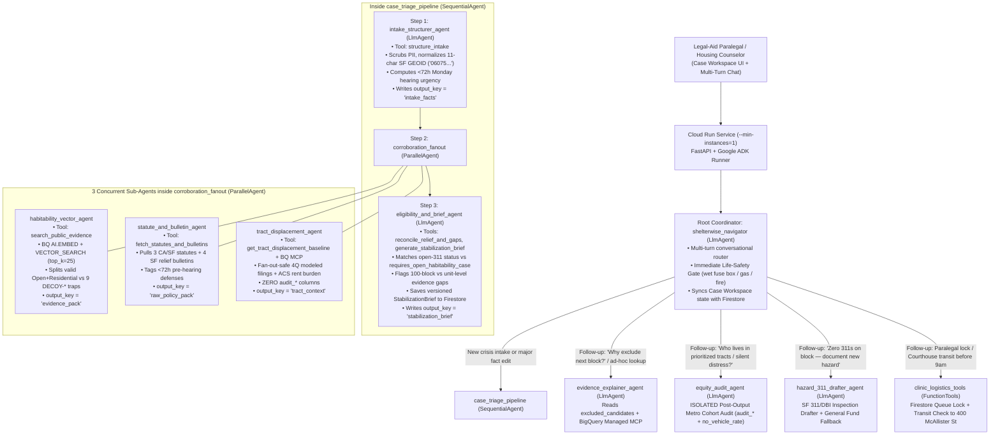
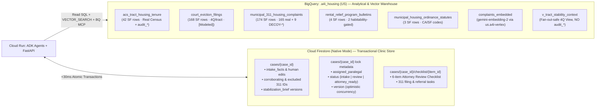

# ShelterWise — Multi-Agent ADK & Dual-Database Architecture

**Challenge:** Agents for Impact 2026 — Affordable Housing Stability & Eviction Prevention (`A4I2026-challenge-housing`)
**Default Metro:** **San Francisco, CA** (`state_code = 'CA'`, `state_fips = '06'`, `metro_area = 'San Francisco'`)
*42 census tracts (`06075...`) · 66,252 renter units · 17.5% severe rent burden (`50%+`) · 2,359 annual `[Modeled]` filings · 140 open real residential 311s + 9 `[Planted Case]` decoys · 4 relief bulletins · 3 CA/SF statutes.*

---

## 1. Executive Summary & Why This Architecture Wins

ShelterWise is **not** a static dashboard or a single SQL query behind a chat box. It is a **multi-turn housing stabilization navigator** built for a legal-aid paralegal or municipal housing coordinator working against a court clock (e.g., **3:40pm Thursday intake for a Monday 9:00am nonpayment hearing**).

To support **both** fast end-to-end case corroboration **and** a natural 20-minute multi-turn conversation, ShelterWise combines:

1. **Google ADK Multi-Agent Orchestration (`LlmAgent` + `SequentialAgent` + `ParallelAgent`):**
   - A conversational **Root Coordinator (`LlmAgent`)** routes live paralegal turns and runs an immediate **Life-Safety Gate** (e.g., water dripping near a fuse/breaker panel).
   - For new intakes or updated facts, it triggers **`case_triage_pipeline` (`SequentialAgent`)**, whose middle stage (**`corroboration_fanout` (`ParallelAgent`)**) executes **3 specialist agents concurrently** (311 Vector Search, Statutes & Relief Bulletins, and Tract Displacement Context), cutting latency from ~16s down to ~4s.
   - For follow-up turns (*"Why did you exclude that boiler complaint?"*, *"Where does 311 under-reporting blind us?"*, *"Help document a brand-new hazard"*), the Root Coordinator delegates to focused specialist sub-agents.
2. **Architectural Responsible-AI Firewall (`equity_audit_agent`):**
   - `audit_*` demographic columns (`audit_black_share`, `audit_hispanic_share`, `audit_asian_share`, `audit_indigenous_share`, `audit_white_share`) are **structurally excluded** from every individual case tool, SQL view, and triage prompt, and are **only** accessible inside an isolated post-output cohort agent (`equity_audit_agent`) that answers aggregate metro equity questions.
3. **Dual-Database Split (`BigQuery` + `Cloud Firestore`):**
   - **BigQuery (`a4i_housing`)** handles read-heavy analytical joins, `GEOGRAPHY`, and `AI.EMBED` + `VECTOR_SEARCH`.
   - **Cloud Firestore (Native Mode)** handles `<30ms` transactional case state, optimistic locking across multiple paralegals (`@firestore.transactional`), human-edited intake facts, and Attorney Review Checklist ticks.
4. **Google-Managed MCP + Custom Python Domain Tools:**
   - Consumes **BigQuery's built-in remote MCP server** (`https://bigquery.googleapis.com/mcp` via ADK `MCPToolset`) for schema inspection and ad-hoc paralegal SQL follow-ups — zero second container to deploy.
   - Pairs MCP with **7 custom Python `FunctionTool`s** encapsulating PII redaction, vector search + decoy rejection, statutory/grant eligibility gating, 311 inspection drafting, and Firestore task locking.

---

## 2. ADK Multi-Agent System Diagram



### Why ADK State Never Collides Inside `ParallelAgent`
In Google ADK, parallel sub-agents share `InvocationContext.session.state`. To avoid race conditions:
1. Each branch in `corroboration_fanout` writes strictly to its own unique `output_key` (`evidence_pack`, `raw_policy_pack`, `tract_context`).
2. Cross-branch business logic — specifically checking whether `evidence_pack.has_open_residential_311 == True` unlocks the two SF grants where `requires_open_habitability_case == True` — runs deterministically in **Step 3 (`eligibility_and_brief_agent`)** after all three parallel branches finish.

---

## 3. Mapping the Full "Thursday 3:40pm" Paralegal Walkthrough

```mermaid
sequenceDiagram
    actor P as Paralegal
    participant R as Root Coordinator (LlmAgent)
    participant Pipe as case_triage_pipeline (Seq + Parallel)
    participant Spec as Specialist Agents + BQ MCP
    participant BQ as BigQuery (Vector + Views)
    participant FS as Cloud Firestore

    P->>R: "Mother of 2, 400 block SF, cold radiators 2 wks, water dripping near kitchen fuse box, Monday 9am hearing."
    R->>P: Immediate Safety Banner (Do NOT touch wet fuse panel; SF DBI / 911 emergency guidance)
    R->>Pipe: Run Sequential -> Parallel Triage
    par Parallel Corroboration (~3-4s)
        Pipe->>BQ: AI.EMBED + VECTOR_SEARCH (top_k=25) -> split valid vs DECOY-*
    and
        Pipe->>BQ: Fetch 3 CA/SF Statutes + 4 SF Relief Bulletins
    and
        Pipe->>BQ: Query v_tract_stability_context (06075... string GEOID, 4Q pre-summed)
    end
    Pipe->>FS: Save Case #SF-1042 + Draft Tenant Stabilization Brief (v1)
    Pipe-->>P: Structured Case Workspace + Corroborated Brief

    P->>R: "Why did you exclude that severe boiler shutdown complaint on the next block?"
    R->>Spec: evidence_explainer_agent reads state['evidence_pack']['excluded_candidates']
    Spec-->>P: "Excluded despite semantic rank #1 (cosine distance 0.19): property_type='Commercial' (or Closed - Abated)."

    P->>R: "Who lives in the tracts our triage rules prioritize, and where might 311 under-reporting blind us?"
    R->>Spec: Transfer to isolated equity_audit_agent
    Spec->>BQ: Cohort SQL joining prioritized vs silent-distress tracts (<=1 open 311) to audit_* & no_vehicle_rate
    Spec-->>P: Metro baseline vs Silent Distress breakdown + mobile outreach recommendation

    P->>R: "No open 311 on a neighbor's block — help document a brand-new hazard & lock task for Attorney Chen."
    R->>Spec: hazard_311_drafter_agent + claim_or_update_case_task
    Spec->>FS: @firestore.transactional lock + save SF 311 inspection draft & route to general arrears funds
    Spec-->>P: Ready-to-file SF 311 checklist + updated brief locked for Attorney Chen
```

### Coverage of Every Core & Stretch Question from the Challenge Brief

| Question Asked by Paralegal / Judge | Component Answering It | Key Guardrail Enforced |
|---|---|---|
| *"Are there open residential habitability complaints near this block matching heat loss or electrical water intrusion?"* | `habitability_vector_agent` → `search_public_evidence` | `AI.EMBED` (`gemini-embedding-2`) + `VECTOR_SEARCH` (`use_brute_force: true`) + post-filter `property_type = 'Residential' AND closed_date IS NULL`. |
| *"Why did you exclude that severe boiler shutdown complaint on the next block?"* | `evidence_explainer_agent` | Explains legitimate business rule (`Commercial`, `Closed - Abated`, `Closed - No Violation`) using zero hardcoded `DECOY-*` string shortcuts. |
| *"Which local statute covers withholding rent or habitability defense for heat and electrical hazards?"* | `statute_and_bulletin_agent` → `fetch_statutes_and_bulletins` | Cites `code_citation` & `ordinance_title` (`[Public Legal Reference]`), flagged for human attorney review. |
| *"Which emergency stabilization fund still fits this household, and does it require an open habitability case?"* | `eligibility_and_brief_agent` → `reconcile_relief_and_gaps` | Gates the 2 `requires_open_habitability_case = TRUE` programs on open residential 311 corroboration; routes to the 2 `FALSE` general funds if none exist. |
| *"How severe is eviction filing pressure and rent burden in this census tract compared with the rest of the metro?"* | `tract_displacement_agent` → `get_tract_displacement_baseline` + **BigQuery MCP** | Pre-aggregates 4 quarters of `court_eviction_filings` (`[Modeled]`) by 11-char `'06075...'` GEOID before joining `acs_tract_housing_tenure`. |
| *"Who lives in the tracts our triage rules prioritize, and where might 311 under-reporting blind us?"* | **`equity_audit_agent`** → `run_metro_equity_audit` | Post-output metro cohort query joining `audit_*` + `no_vehicle_rate` + `severe_rent_burden_pct` without ever scoring individual tenants by race. |
| *"Draft the intake corroboration memo and relief referral packet so the attorney can review it tonight."* | `eligibility_and_brief_agent` → `generate_stabilization_brief` | Produces the 9-section **Tenant Stabilization Brief** with explicit 100-block evidentiary caveats and 6-item Reviewer Checklist. |
| **Stretch (+10 Bonus):** *"Track open intake tasks across three paralegals without overwriting each other"* | **Cloud Firestore** + `claim_or_update_case_task` | `@firestore.transactional` optimistic concurrency (`lock_version`, `assigned_paralegal`). |
| **Stretch (+10 Bonus):** *"Help a tenant document a brand-new hazard not yet reported to 311"* | `hazard_311_drafter_agent` → `draft_311_inspection_request` | Generates SF 311/DBI category + safe photo checklist + routes to `requires_open_habitability_case = FALSE` funds while inspection is pending. |
| **Stretch (+10 Bonus):** *"Can the tenant reach the courthouse by bus before 9am Monday?"* | `estimate_courthouse_transit` | Computes distance/transit estimate from block `latitude, longitude` to SF Civic Center Courthouse (`400 McAllister St, San Francisco`). |

---

## 4. Dual-Database Architecture (`BigQuery` + `Cloud Firestore`)



### Why Firestore (and Not Cloud SQL) Alongside BigQuery
- **BigQuery** is an analytical columnar warehouse (1–2s DML latency, no row-level clinic queue locks).
- **Cloud Firestore** provisions in **5 seconds** (`gcloud firestore databases create --location=nam5`), uses Application Default Credentials with **zero VPC connectors or passwords**, and gives `@firestore.transactional` optimistic locking so three paralegals never overwrite each other's edits. *(Includes an automatic in-memory fallback when running offline `pytest`.)*

---

## 5. Verified BigQuery Schemas & Required SQL Setup

### A. Exact Column Reference Across All 5 Starter Tables

| Table | Primary / Join Key | Exact Columns |
|---|---|---|
| `acs_tract_housing_tenure` | `census_tract_geoid` (`STRING`, 11 chars `'06075...'`) | `census_tract_geoid`, `state_code`, `county_fips`, `county_name`, `metro_area`, `total_population`, `total_households`, `renter_occupied_units`, `median_household_income`, `median_gross_rent`, `renter_hh_rent_30_to_49_pct_count`, `renter_hh_rent_50_pct_plus_count`, `poverty_rate`, `no_vehicle_rate`, `assistance_rate`, `audit_black_share`, `audit_hispanic_share`, `audit_asian_share`, `audit_indigenous_share`, `audit_white_share`, `latitude`, `longitude`, `data_provenance`, `tract_geom` |
| `court_eviction_filings` | `filing_record_id` (`4` rows per `census_tract_geoid`) | `filing_record_id`, `census_tract_geoid`, `state_code`, `metro_area`, `county_name`, `reporting_quarter`, `nonpayment_filings_count`, `holdover_or_no_fault_filings_count`, `default_judgments_count`, `median_claimed_arrears_usd`, `data_provenance` |
| `municipal_311_housing_complaints` | `request_id` | `request_id`, `state_code`, `metro_area`, `jurisdiction`, `block_address`, `census_tract_geoid`, `agency_code`, `property_type`, `raw_complaint_type`, `complaint_narrative`, `inspection_status`, `latitude`, `longitude`, `data_provenance`, `created_date`, `closed_date`, `property_geom` |
| `rental_relief_program_bulletins` | `bulletin_id` | `bulletin_id`, `state_code`, `metro_area`, `service_region`, `program_name`, `administering_agency`, `funding_stream`, `requires_open_habitability_case`, `residential_tenants_only`, `raw_bulletin_text`, `intake_url`, `data_provenance`, `effective_date` |
| `municipal_housing_ordinance_statutes` | `statute_section_id` | `statute_section_id`, `state_code`, `metro_area`, `jurisdiction`, `code_citation`, `ordinance_title`, `raw_statute_text`, `data_provenance` |

### B. One-Time BigQuery Vector & Fan-Out-Safe View SQL (`sql/setup_vector_and_views.sql`)

> **Important catch:** Notebook Section 13's `CREATE TABLE complaints_embedded` omits `created_date`, `jurisdiction`, `agency_code`, and `data_provenance`. Our `search_public_evidence` query **joins `VECTOR_SEARCH(TABLE complaints_embedded, ...)` back to `municipal_311_housing_complaints` on `request_id`** so every citation field is guaranteed present regardless of how `complaints_embedded` was created.

```sql
-- 1. Materialize 311 embeddings once using Vertex AI connection us.a4i-vertex
CREATE OR REPLACE TABLE `a4i_housing.complaints_embedded` AS
SELECT
  request_id, state_code, metro_area,
  LPAD(CAST(census_tract_geoid AS STRING), 11, '0') AS census_tract_geoid,
  block_address, property_type, raw_complaint_type,
  inspection_status, closed_date, complaint_narrative,
  embedded.result AS embedding
FROM (
  SELECT *,
    AI.EMBED(
      complaint_narrative,
      connection_id => 'us.a4i-vertex',
      endpoint => 'gemini-embedding-2'
    ) AS embedded
  FROM `a4i_housing.municipal_311_housing_complaints`
)
WHERE embedded.status = '';

-- 2. Fan-out-safe Tract Stability View (pre-aggregates 4 quarters; omits all audit_* columns)
CREATE OR REPLACE VIEW `a4i_housing.v_tract_stability_context` AS
WITH annual_filings AS (
  SELECT
    LPAD(CAST(census_tract_geoid AS STRING), 11, '0') AS census_tract_geoid,
    SUM(nonpayment_filings_count) AS annual_nonpayment_filings,
    SUM(holdover_or_no_fault_filings_count) AS annual_no_fault_filings,
    SUM(nonpayment_filings_count + holdover_or_no_fault_filings_count) AS annual_filings_total,
    SUM(default_judgments_count) AS annual_defaults_total,
    ROUND(AVG(median_claimed_arrears_usd), 0) AS avg_claimed_arrears_usd,
    ANY_VALUE(data_provenance) AS filings_provenance
  FROM `a4i_housing.court_eviction_filings`
  GROUP BY 1
),
open_res_311 AS (
  SELECT
    LPAD(CAST(census_tract_geoid AS STRING), 11, '0') AS census_tract_geoid,
    COUNT(*) AS open_residential_311_count
  FROM `a4i_housing.municipal_311_housing_complaints`
  WHERE property_type = 'Residential'
    AND closed_date IS NULL
    AND NOT STARTS_WITH(LOWER(inspection_status), 'closed')
  GROUP BY 1
)
SELECT
  LPAD(CAST(a.census_tract_geoid AS STRING), 11, '0') AS census_tract_geoid,
  a.state_code,
  a.metro_area,
  a.county_name,
  a.renter_occupied_units,
  a.median_household_income,
  a.median_gross_rent,
  a.renter_hh_rent_30_to_49_pct_count,
  a.renter_hh_rent_50_pct_plus_count,
  ROUND(SAFE_DIVIDE(a.renter_hh_rent_50_pct_plus_count, a.renter_occupied_units) * 100, 1) AS severe_rent_burden_pct,
  ROUND(a.poverty_rate * 100, 1) AS poverty_pct,
  ROUND(a.no_vehicle_rate * 100, 1) AS no_vehicle_pct,
  COALESCE(f.annual_nonpayment_filings, 0) AS annual_nonpayment_filings,
  COALESCE(f.annual_no_fault_filings, 0) AS annual_no_fault_filings,
  COALESCE(f.annual_filings_total, 0) AS annual_filings_total,
  COALESCE(f.annual_defaults_total, 0) AS annual_defaults_total,
  COALESCE(f.avg_claimed_arrears_usd, 0) AS avg_claimed_arrears_usd,
  COALESCE(c.open_residential_311_count, 0) AS open_residential_311_count,
  (COALESCE(c.open_residential_311_count, 0) <= 1
   AND SAFE_DIVIDE(a.renter_hh_rent_50_pct_plus_count, a.renter_occupied_units) >= 0.20) AS is_silent_distress_candidate,
  a.latitude AS tract_lat,
  a.longitude AS tract_lon,
  a.data_provenance AS acs_provenance,
  f.filings_provenance
FROM `a4i_housing.acs_tract_housing_tenure` AS a
LEFT JOIN annual_filings AS f
  ON LPAD(CAST(a.census_tract_geoid AS STRING), 11, '0') = f.census_tract_geoid
LEFT JOIN open_res_311 AS c
  ON LPAD(CAST(a.census_tract_geoid AS STRING), 11, '0') = c.census_tract_geoid;
```

---

## 6. Custom Tools Inventory (Agent & Tools Lane Specification)

All tools follow Google ADK `FunctionTool` conventions: primitive LLM-friendly parameter types, `tool_context: ToolContext` state injection, and structured `dict` returns (`{"status": "success", ...}`).

| # | Tool Name | Attached Agent | Exact Responsibility |
|---|---|---|---|
| **1** | `structure_intake` | `intake_structurer_agent` | Detects immediate life-safety hazards (water near electrical panel, gas, fire, raw sewage), scrubs residual PII before embedding, normalizes 11-char `'06075...'` GEOIDs, computes `<72h` court-hearing urgency, and produces `semantic_search_query`. |
| **2** | `search_public_evidence` | `habitability_vector_agent` | Runs parameterized BigQuery `AI.EMBED` + `VECTOR_SEARCH` (`top_k=25`, `use_brute_force=true`) joined to `municipal_311_housing_complaints`. Applies **legitimate business-rule validation** (`metro_area`, `property_type == 'Residential'`, `closed_date IS NULL`, active `inspection_status`) — returning both **`corroborating_records`** and **`excluded_candidates`** (catching all 9 `DECOY-*` cases with exact `cosine_distance`, pre-filter rank, and exclusion reason). |
| **3** | `fetch_statutes_and_bulletins` | `statute_and_bulletin_agent` | Queries `municipal_housing_ordinance_statutes` (3 rows) and `rental_relief_program_bulletins` (4 rows) for `@metro`, annotating deadline-sensitive statutory defenses. |
| **4** | `get_tract_displacement_baseline` | `tract_displacement_agent` | Queries `v_tract_stability_context` + SF metro medians (`severe_rent_burden_pct`, `annual_filings_total`, `open_residential_311_count`, `is_silent_distress_candidate`) with zero 4× fan-out and zero `audit_*` access. |
| **5** | `reconcile_gaps_and_generate_brief` | `eligibility_and_brief_agent` | Cross-checks `evidence_pack.has_open_residential_311` against `requires_open_habitability_case`, generates unit-level evidence gaps, compiles the 9-section **Tenant Stabilization Brief** (`JSON` + `Markdown`) with provenance badges, and persists to Firestore. |
| **6** | `draft_311_inspection_request` | `hazard_311_drafter_agent` | **+10 Bonus:** When a tenant's block has 0 open 311s, structures an SF 311/DBI inspection filing summary + safe photo documentation checklist + immediate fallback routing to `requires_open_habitability_case = FALSE` funds. |
| **7** | `run_metro_equity_audit` | `equity_audit_agent` *(isolated)* | **Post-Output Responsible AI:** Computes metro-wide comparison of open-311-prioritized tracts vs. "silent distress" tracts joined to `audit_*` shares and `no_vehicle_rate`. |
| **8** | `claim_or_update_case_task` & `estimate_courthouse_transit` | `shelterwise_navigator` (Root) | **+10 Bonus:** Firestore `@firestore.transactional` multi-paralegal case locking/checklist updates + transit feasibility estimate from block coordinates to SF Superior Court (`400 McAllister St`) before 9:00am. |

---

## 7. Proposed Code Layout Inside `ShelterWise/`

```text
ShelterWise/
├── docs/
│   └── AGENTIC_ARCHITECTURE.md                # This shared team blueprint
├── sql/
│   └── setup_vector_and_views.sql             # Creates complaints_embedded + v_tract_stability_context
├── agent/
│   ├── requirements.txt                       # google-adk, google-genai, google-cloud-bigquery, google-cloud-firestore, fastapi, uvicorn, pydantic
│   ├── Dockerfile                             # Cloud Run container (--min-instances=1)
│   ├── deploy_cloud_run.sh                    # One-command Cloud Run deployment
│   ├── server.py                              # FastAPI gateway (/api/triage, /api/chat, /api/cases) + ADK Runner
│   ├── shelterwise_agent/
│   │   ├── __init__.py                        # Exports root_agent for `adk web` & Cloud Run
│   │   ├── config.py                          # Env vars: PROJECT_ID, DATASET=a4i_housing, METRO="San Francisco", VERTEX_CONN="us.a4i-vertex"
│   │   ├── schemas.py                         # Canonical Pydantic v2 JSON contracts shared with Frontend
│   │   ├── agent.py                           # Root LlmAgent + SequentialAgent + ParallelAgent + Specialist Sub-Agents
│   │   ├── mcp/
│   │   │   └── bigquery_mcp.py                # Managed BigQuery MCPToolset (https://bigquery.googleapis.com/mcp)
│   │   ├── db/
│   │   │   ├── bigquery_client.py             # Parameterized SQL + VECTOR_SEARCH + offline fixture fallback for tests
│   │   │   └── firestore_store.py             # Transactional multi-paralegal case store + in-memory test fallback
│   │   └── tools/
│   │       ├── intake.py                      # structure_intake (safety gate + PII scrub + SF GEOID check)
│   │       ├── evidence.py                    # search_public_evidence (VECTOR_SEARCH + business-rule decoy catcher)
│   │       ├── policy.py                      # fetch_statutes_and_bulletins
│   │       ├── tract.py                       # get_tract_displacement_baseline
│   │       ├── brief.py                       # reconcile_gaps_and_generate_brief
│   │       ├── drafter_311.py                 # draft_311_inspection_request (+10 bonus)
│   │       ├── equity_audit.py                # run_metro_equity_audit (isolated to equity_audit_agent)
│   │       └── logistics.py                   # claim_or_update_case_task + estimate_courthouse_transit
│   └── tests/
│       ├── test_decoy_rejection.py            # Verifies all 3 decoy classes (Commercial, Abated, No-Violation) caught & explained
│       ├── test_sf_geoid_and_audit_firewall.py# Verifies '06075...' leading zero intact & zero audit_* in case tools
│       └── test_triage_pipeline.py            # End-to-end tool & brief contract verification
└── frontend/                                  # Case Workspace Web UI consuming /api/triage, /api/chat, /api/cases
```

---

## 8. 6-Member Parallel Implementation Plan (Zero-Collision Split)

| Member | Role & Branch | Immediate Deliverables | Exclusive Files Owned |
|---|---|---|---|
| **Member 1 (Sarav) ** | **BigQuery Data, Embeddings & Views** (`data-bq`) | 1. `bash scripts/load.sh san-francisco`<br>2. Create `us.a4i-vertex` + `roles/aiplatform.user`<br>3. Run `sql/setup_vector_and_views.sql` (`complaints_embedded` + `v_tract_stability_context`)<br>4. Verify Section 12's 26 checks | `sql/setup_vector_and_views.sql`, `scripts/setup_bigquery.sh` |
| **Member 2 (Shiva)** | **Schemas & 5 Core Triage Custom Tools** (`shiva`) | 1. `schemas.py` + `config.py` (ship first to unblock M3, M4, M5)<br>2. `bigquery_client.py` (with offline SF fixtures)<br>3. 5 Core Tools: `intake`, `evidence` (`VECTOR_SEARCH` + 9-decoy post-filter), `policy`, `tract`, `brief` | `agent/shelterwise_agent/config.py`, `schemas.py`, `db/bigquery_client.py`, `tools/{intake,evidence,policy,tract,brief}.py` |
| **Member 3** | **ADK Multi-Agent Tree & Managed MCP** (`adk-agents`) | 1. Managed BigQuery `MCPToolset` (`bigquery_mcp.py`)<br>2. ADK `LlmAgent` + `SequentialAgent` + `ParallelAgent` (`agent.py`)<br>3. Specialist Sub-Agents (`evidence_explainer_agent`, `equity_audit_agent`, `hazard_311_drafter_agent`) | `agent/shelterwise_agent/agent.py`, `__init__.py`, `mcp/bigquery_mcp.py` |
| **Member 4** | **Firestore, Bonus Tools, FastAPI & Cloud Run** (`platform-deploy`) | 1. Cloud Firestore (`nam5`) + `firestore_store.py` (`@firestore.transactional` lock)<br>2. Bonus/Audit Tools: `drafter_311`, `equity_audit`, `logistics` (`400 McAllister St` transit + case lock)<br>3. FastAPI `server.py` + `Dockerfile` + Cloud Run deploy (`--min-instances=1`) | `agent/shelterwise_agent/db/firestore_store.py`, `tools/{drafter_311,equity_audit,logistics}.py`, `agent/server.py`, `Dockerfile`, `requirements.txt`, `deploy_cloud_run.sh` |
| **Hualin Ding** | **Case Workspace Web UI** (`frontend`) | Case Workspace UI (`Intake` → `Safety Banner` → `Evidence Room (Valid + Excluded Decoys)` → `Statutes & Relief` → `Stabilization Brief + Paralegal Lock` + `Multi-Turn Chat`) | `frontend/*` |
| **Member 6** | **QA Red-Team, Pitch Deck & <=3m Video** (`story-qa`) | 1. `pytest` & live red-team suite (`agent/tests/*`)<br>2. Update SF slides + provenance + SF Post-Output Equity Audit table<br>3. Record `<=3:00` walkthrough video & submit | `agent/tests/*`, `slides/*`, `qa/*` |
