# HN Radar — End-to-End System Architecture Specification

> **Document Type:** System Architecture & Technical Design Document  
> **Source Repository:** [researchsite/hn-radar](https://github.com/researchsite/hn-radar)  
> **Synthesis Scope:** Complete integration across all 26 closed Pull Requests (#1 through #53) and Qodo Bot Review Diagrams.

---

## 1. Executive Summary & Core Mission

**HN Radar** is an autonomous intelligence and matchmaking engine designed around a single guiding principle: **"Arrive with the fix."**

Instead of sending generic job applications or cold outreach messages, HN Radar connects developers to high-signal opportunities on Hacker News by:
1. Ingesting monthly *"Ask HN: Who is hiring?"* threads, parsing job postings, discarding candidate self-pitches, and verifying active status against poster replies.
2. Generating a privacy-respecting **Developer Fingerprint** from public GitHub repositories (languages, topics, notable repos).
3. Deterministically **scoring and matching** jobs against the developer profile with transparent, cited evidence (Rule 1).
4. Discovering relevant **Show HN** product posts for target companies with domain-restricted search, strict ownership semantics (Rule 9), and platform domain risk filtering (PR #50).
5. Extracting actionable sentiment—**pros, bugs, and asks**—from Show HN comments using a local LLM (Ollama), requiring comment-ID citations for every claim.
6. Generating an exact **5-line cited outreach note** via `hnradar draft` (PR #51) that pairs an authentic user-reported bug with the developer's specific open-source repository.
7. Providing **resilient on-disk caching** (PR #53) where read-only or permission-denied cache paths warn safely to stderr and never abort successful data fetches.
8. Governing all human and AI code changes through a rigid **Autonomous Software Engineering Factory** (Goose recipes, mutex-protected pollers, real-data verification skills, and Qodo automated code reviews enforcing the 10 rules of `AGENTS.md`).

---

## 2. High-Level Unified System Architecture

The following diagram unifies the entire HN Radar ecosystem, mapping external APIs, source adapters, storage layers, processing pipelines, user CLI commands, security boundaries, and the autonomous agent factory.

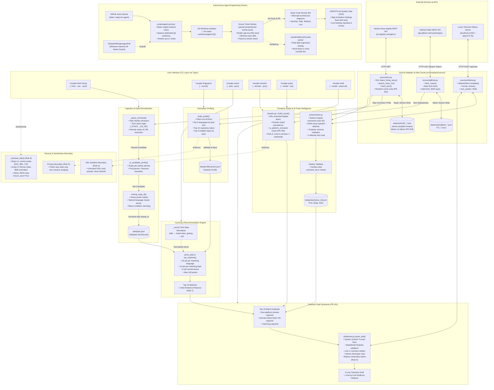

---

## 3. Subsystem Deep-Dive Diagrams

### 3.1. Job Ingestion & Sanitization Pipeline (Data Flow)

When `hnradar fetch-hiring` executes, it performs a complete sweep across the monthly Hacker News thread.

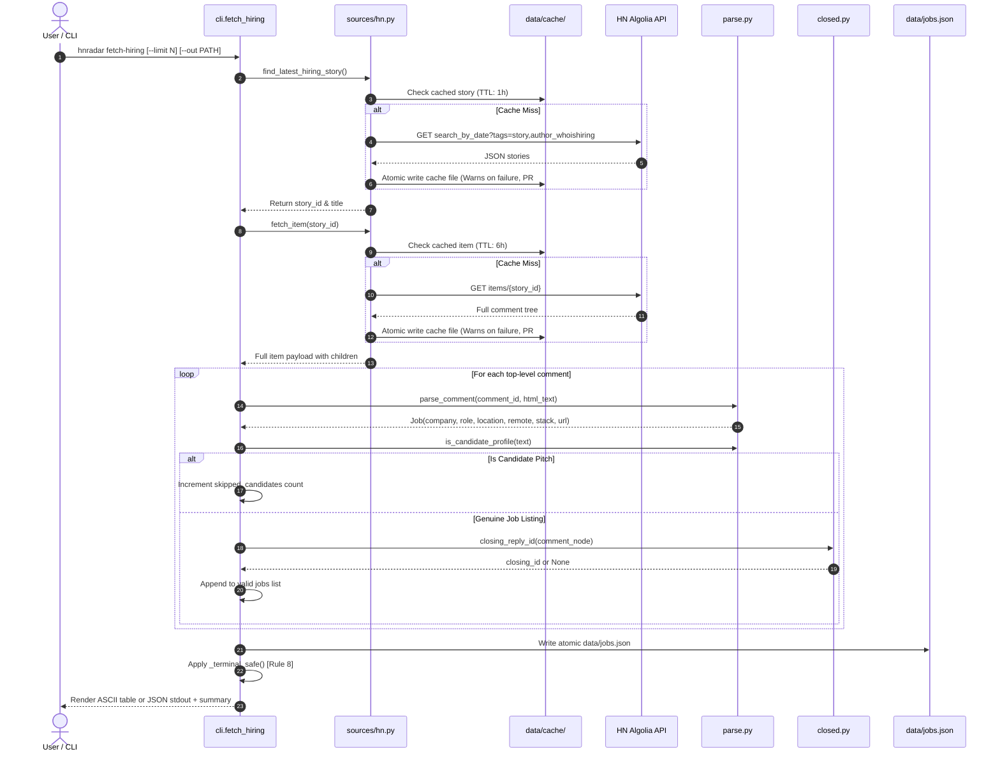

---

### 3.2. Developer Fingerprinting & Deterministic Match Pipeline

The `fingerprint` and `match` commands work in tandem to provide transparent, cited career recommendations.

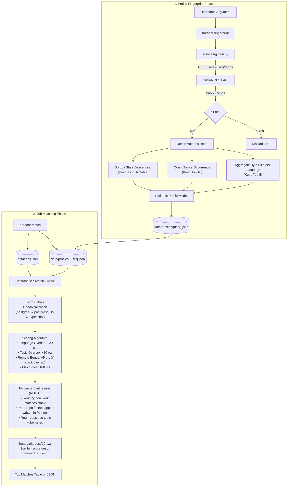

---

### 3.3. Pulse Qualitative Sentiment Pipeline (Ollama LLM)

The `pulse` command utilizes a local LLM to structure feedback into pros, bugs, and asks with strict citation guarantees.

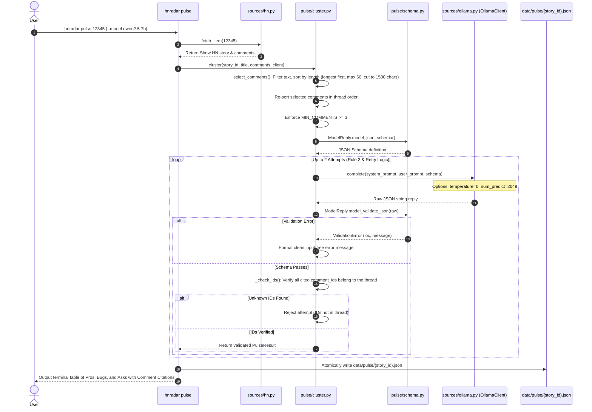

---

### 3.4. 5-Line Outreach Draft Generation Pipeline (`hnradar draft` — PR #51)

The `draft` command brings together developer profile matching, company domain validation, Show HN sentiment bugs, and local LLM composition into an exact 5-line cited outreach note.

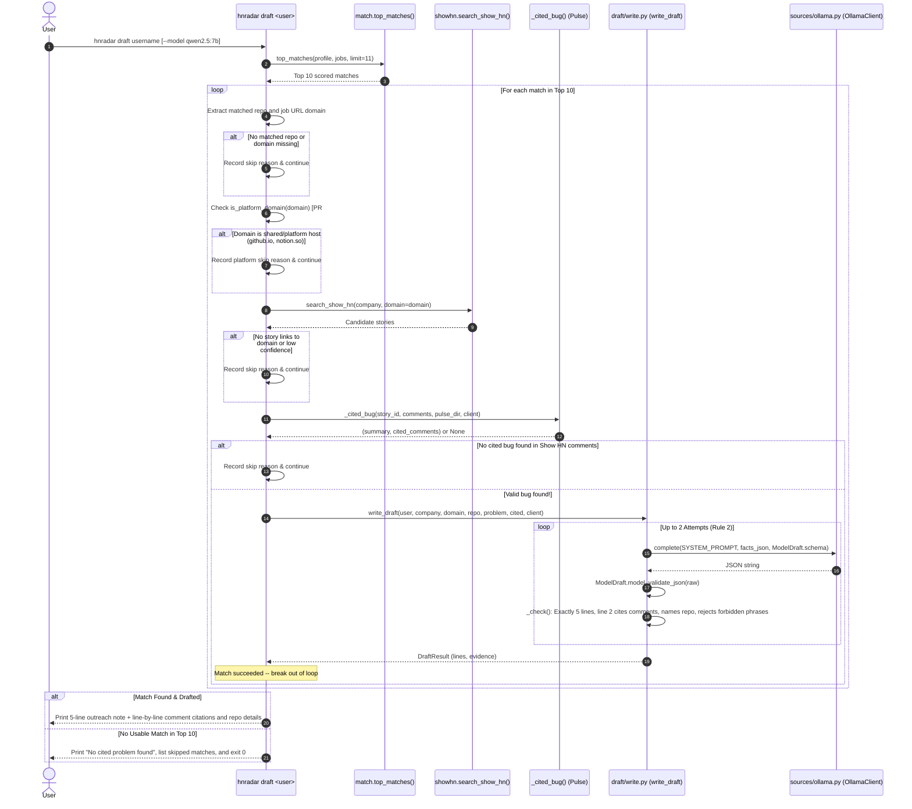

---

### 3.5. Autonomous Agent Factory & Quality Gate Cycle

The project implements a fully autonomous ticket-worker loop with rigorous architectural oversight.

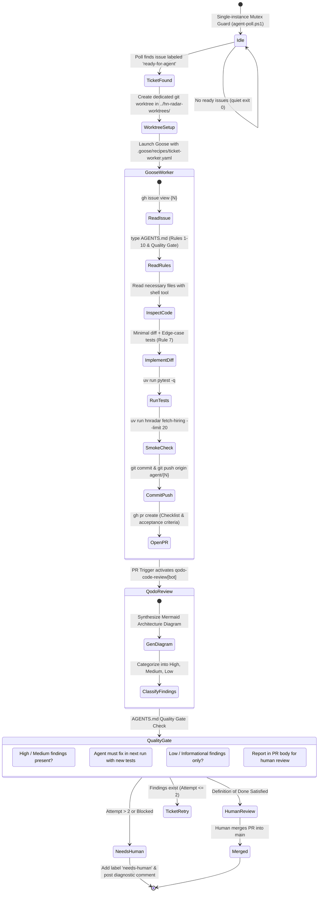

---

## 4. Comprehensive Catalog of Qodo PR Diagrams

The following section catalogues the architectural diagrams generated by **Qodo Code Review** across all 26 closed Pull Requests in `researchsite/hn-radar`, documenting the chronological evolution of the system.

### PR #1: feat: add hnradar fetch-hiring command
- **Status:** `Merged`
- **Architectural Contribution:** Initial foundation PR. Added fetch-hiring command and core parser. (Qodo automated review errored on first run; diagram synthesized from PR code).

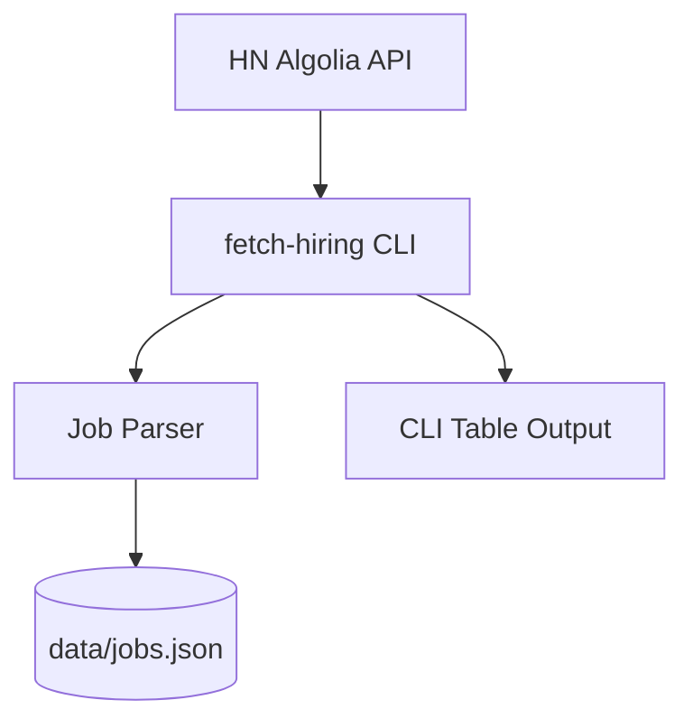

---
### PR #2: docs: AGENTS.md factory rules
- **Status:** `Merged`
- **Architectural Contribution:** Codified the initial 5 AGENTS.md factory rules governing citation, schema validation, network isolation, sandboxing, and minimal personal data.

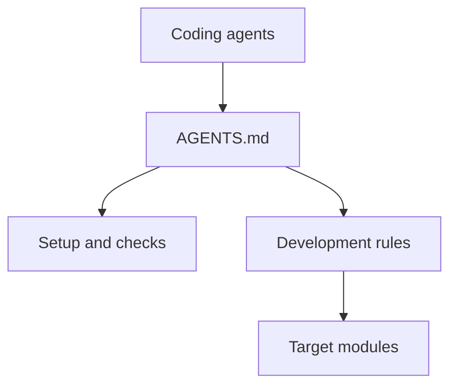

---
### PR #6: feat: add hnradar fingerprint command (#3)
- **Status:** `Merged`
- **Architectural Contribution:** Added GitHub user fingerprinting, analyzing up to 2000 public repos (excluding forks) to extract top 5 languages, top 10 topics, and top 5 notable repos.

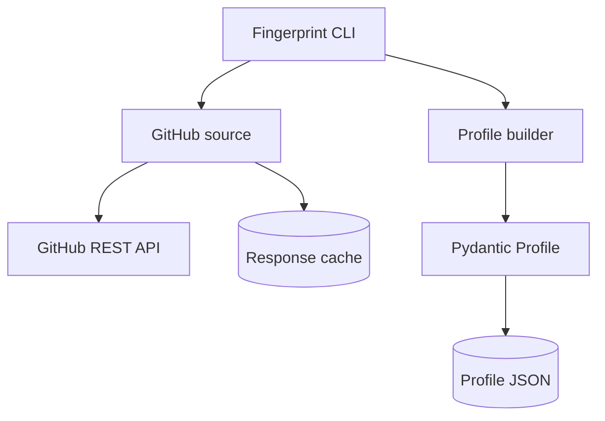

---
### PR #7: docs: add AGENTS.md rules 6 and 7 (limits fail loudly, edge-case tests)
- **Status:** `Merged`
- **Architectural Contribution:** Introduced Rule 6 (limits fail loudly, no truncated silent outputs) and Rule 7 (every PR must ship edge-case tests for empty, limit, over-limit, and upstream errors).

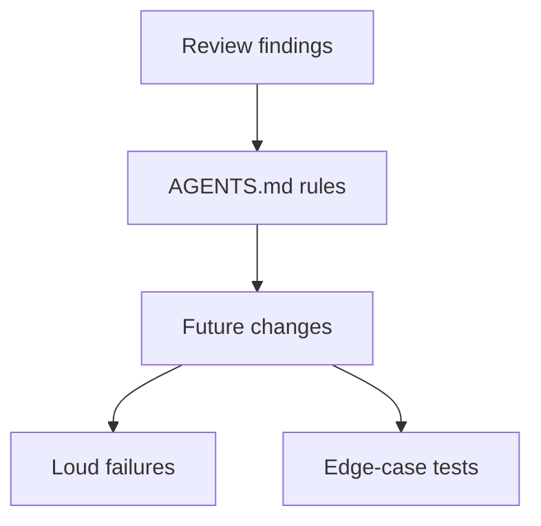

---
### PR #8: feat: add Goose ticket-worker recipe and agent poller
- **Status:** `Merged`
- **Architectural Contribution:** Created autonomous engineering pipeline: PowerShell poller with OS named mutex single-instance guard and Goose ticket-worker recipe operating in isolated worktrees.

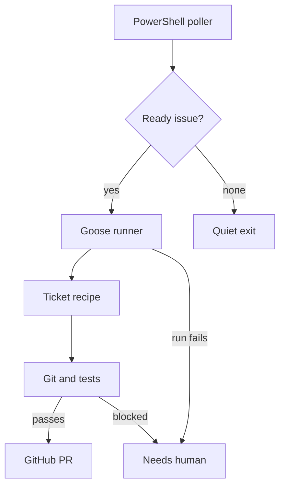

---
### PR #9: feat: add --json option to fetch-hiring (#5)
- **Status:** `Merged`
- **Architectural Contribution:** Added --json option and clean terminal table default for fetch-hiring, allowing composable piping into downstream tools.

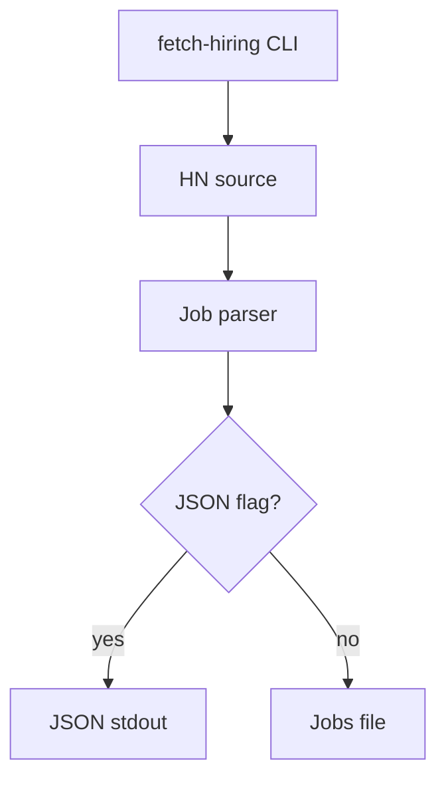

---
### PR #10: fix: cloud model and stricter tool rules for the ticket worker
- **Status:** `Merged`
- **Architectural Contribution:** Upgraded worker to gpt-oss:20b-cloud, added strict directives forbidding deleting existing code and requiring full file writes.

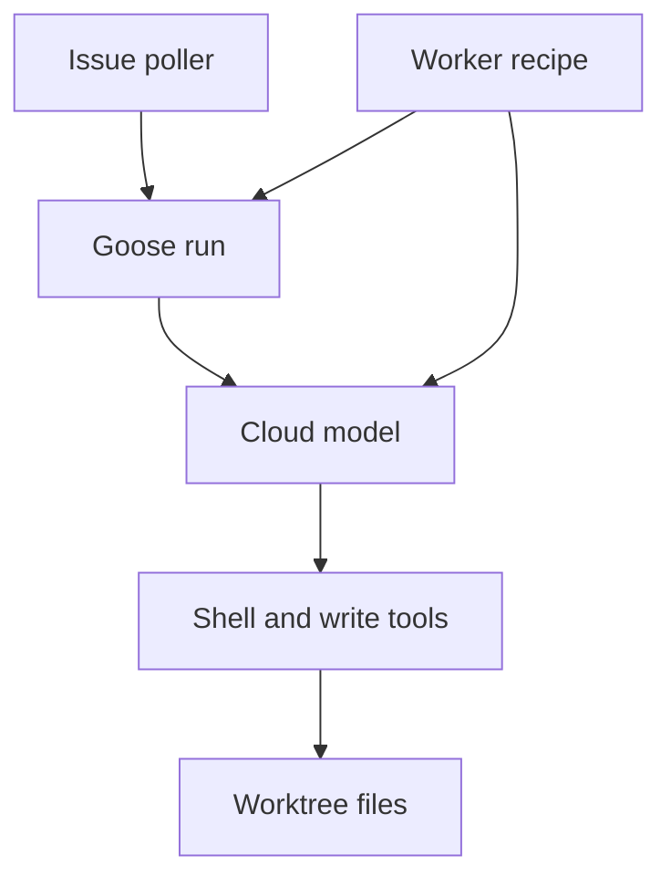

---
### PR #11: feat: rule 8 - clean untrusted post text before printing
- **Status:** `Merged`
- **Architectural Contribution:** Added Rule 8: untrusted text from HN/GitHub must be cleaned before printing (strips Cc control characters, Cf bidi overrides; ensure_ascii=True on stdout JSON).

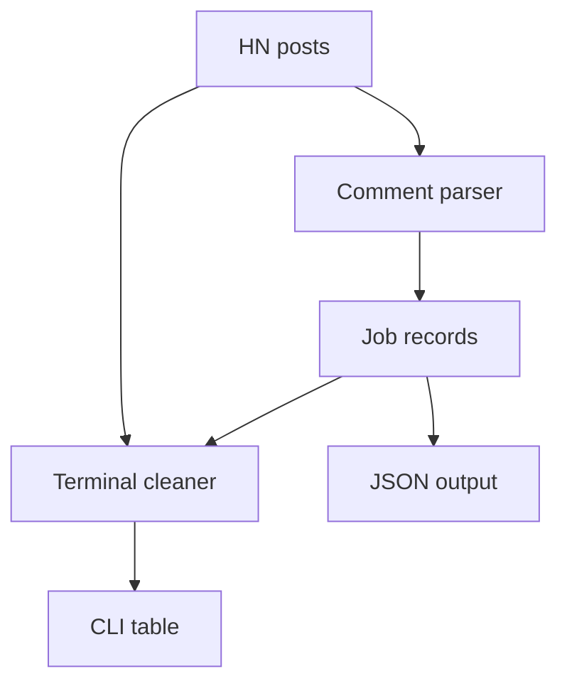

---
### PR #21: feat: hnradar showhn - find a company's Show HN story
- **Status:** `Merged`
- **Architectural Contribution:** Introduced showhn command to discover Show HN posts via Algolia, ranking by domain match, points, and recency with atomic cache writes.

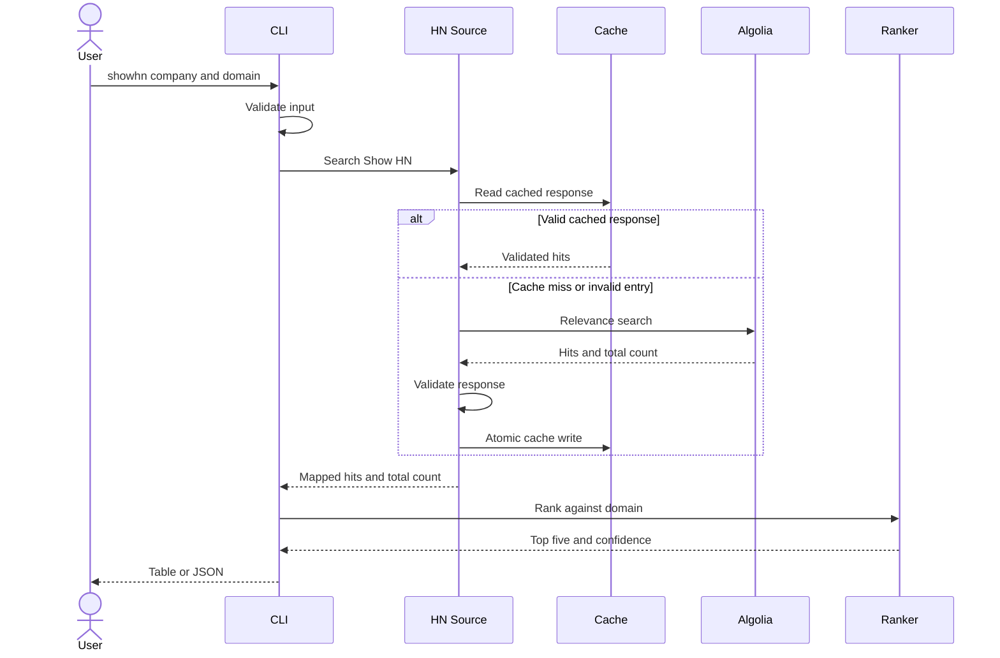

---
### PR #22: docs: add quality gate (definition of done) to AGENTS.md and the ticket-worker recipe
- **Status:** `Merged`
- **Architectural Contribution:** Formalized Definition of Done: High and Medium findings must be fixed with tests, Low findings reported, disagreements require code citations, latest commit covered.

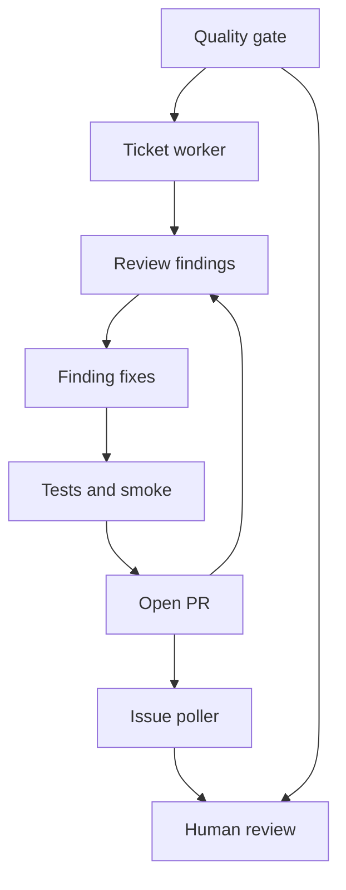

---
### PR #24: feat: hnradar match - top 3 jobs for a user (#12)
- **Status:** `Merged`
- **Architectural Contribution:** Introduced match command: deterministic scoring (20 pts language, 10 pts topic, 5 pts remote bonus, max 100), alias normalization, and cited reason generation.

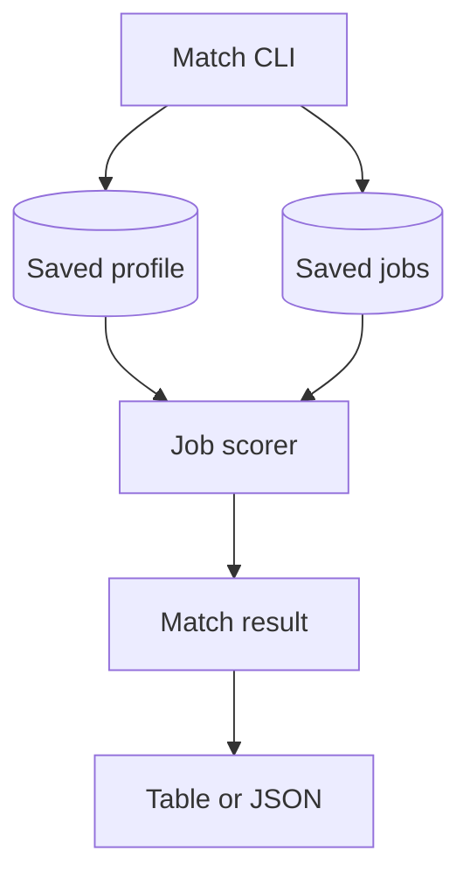

---
### PR #28: docs: pre-review checklist in AGENTS.md
- **Status:** `Merged`
- **Architectural Contribution:** Added 9-point pre-review checklist addressing recurring defect patterns (ticket line-by-line, clean input failures, ambiguity rejection, identity checking).

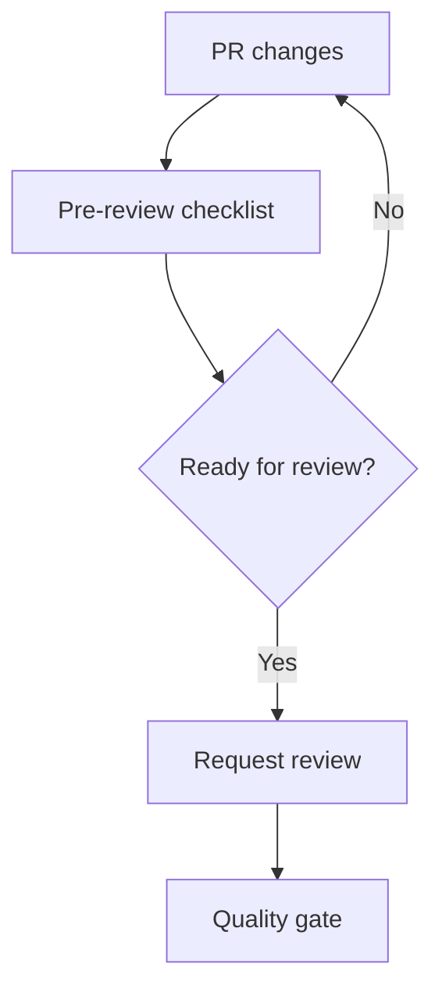

---
### PR #29: docs: README with setup and how to run every command
- **Status:** `Merged`
- **Architectural Contribution:** Added full repository README with setup, uv invocation patterns, and command documentation for fetch-hiring, showhn, fingerprint, and match.

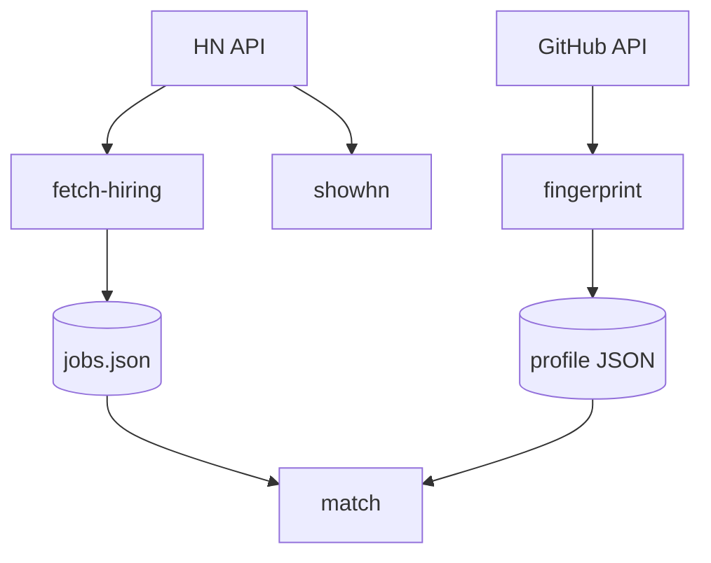

---
### PR #30: feat: flag closed jobs from the poster's own replies (#25)
- **Status:** `Merged`
- **Architectural Contribution:** Added closed.py parser: analyzes author's child replies to detect closing notices with natural language clause parsing and bisect positioning.

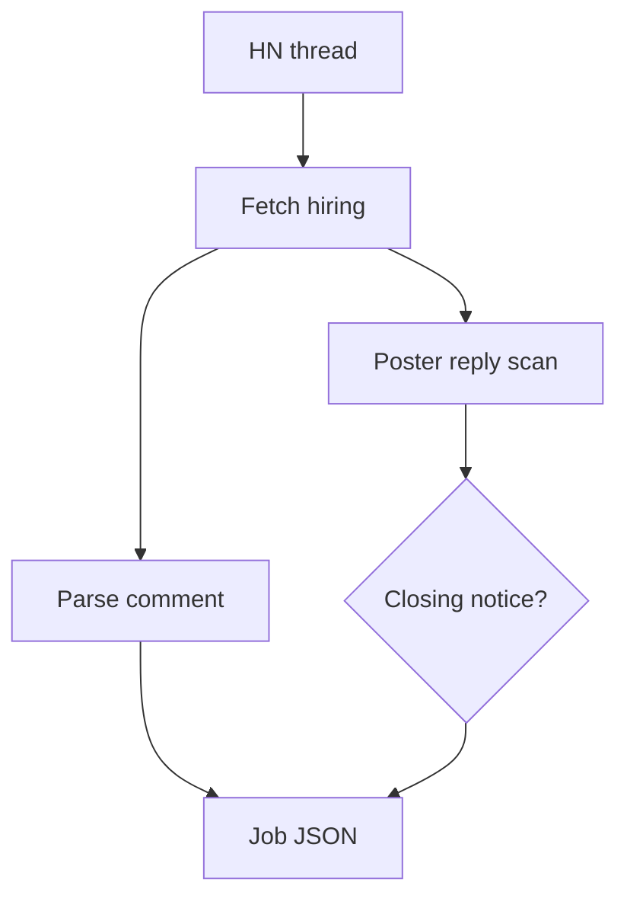

---
### PR #33: feat: showhn URL-restricted domain query (#20)
- **Status:** `Merged`
- **Architectural Contribution:** Added secondary Algolia search with restrictSearchableAttributes=url when --domain is provided, deduplicating IDs and aggregating total counts.

```mermaid
sequenceDiagram
    actor User
    participant CLI as showhn CLI
    participant Search as HN search
    participant Cache as Response cache
    participant API as Algolia API
    participant Rank as Result ranking
    User->>CLI: company and optional domain
    CLI->>Search: search_show_hn
    Search->>Cache: look up name query
    opt cache miss
        Search->>API: name search
        API-->>Search: name hits
        Search->>Cache: save validated response
    end
    opt domain provided
        Search->>Cache: look up URL query
        opt cache miss
            Search->>API: URL-restricted search
            API-->>Search: URL hits
            Search->>Cache: save validated response
        end
        Note over Search: Deduplicate IDs and compute total
    end
    Search-->>CLI: hits and total or error
    CLI->>Rank: build_result
    Rank-->>CLI: domain-first top five
    CLI-->>User: candidates or error
```

---
### PR #34: experiment: showhn fallback and labels (Day 11, do not merge)
- **Status:** `Experiment (Closed, Not Merged)`
- **Architectural Contribution:** Experimental run evaluating fallback behaviors and label cues when URL search fails or domain is absent.

```mermaid
graph TD
  CLI["showhn CLI"] --> Name["Name search"] --> Domain{"Domain provided?"} -->|yes| URL["URL search"] -->|available| Merge["Deduplicate hits"] --> Rank["Rank candidates"] --> Out["Table or JSON"]
  Domain -->|no| Rank
  URL -->|unavailable| Rank
```

---
### PR #35: docs: AGENTS.md rule 9, a domain match is never company ownership
- **Status:** `Merged`
- **Architectural Contribution:** Added Rule 9: a domain match means a story links to that domain, never that the company owns it or posted it (protects against multi-tenant platforms like notion.so).

```mermaid
graph TD
  A["AGENTS.md rule 9"] --> B["Qodo re-import"] --> C["Future reviews"] --> D["Show HN wording"]
```

---
### PR #36: experiment: showhn domain search (Day 11 run B, do not merge)
- **Status:** `Experiment (Closed, Not Merged)`
- **Architectural Contribution:** Second experiment testing unified search coordinator structure for name and URL search.

```mermaid
graph TD
  CLI["showhn CLI"] --> Search["Search coordinator"] --> Name["Name search"] --> Merge["Deduplicate hits"] --> Rank["Rank candidates"] --> Output["Table or JSON"]
  Search -->|"if domain"| URL["URL search"] --> Merge
```

---
### PR #39: docs: AGENTS.md rule 10, a failed upstream request is never returned as complete
- **Status:** `Merged`
- **Architectural Contribution:** Added Rule 10: any failed request to Algolia, GitHub, or Ollama must raise an error and exit 1; never swallow failures into partial results.

```mermaid
graph TD
  U["Upstream services"] --> S["Source adapters"] --> C["CLI commands"] --> O["Visible outcome"]
  R["Rule 10"] -. governs .-> S
  R -. governs .-> C
```

---
### PR #43: feat: careers-only full-text search with its own Pagefind index (#40)
- **Status:** `Merged`
- **Architectural Contribution:** Integrated Pagefind static indexing over jobs.json for full-text careers search with field-level fallback.

```mermaid
graph TD
  Jobs[("Jobs JSON")] --> Builder["Index builder"] --> CLI["Pagefind CLI"] --> Index[("Careers index")] --> Helper["HN search"] --> Explorer["Job explorer"]
  Jobs --> Explorer
  Helper -->|"Index unavailable"| Fallback["Field fallback"] --> Explorer
```

---
### PR #46: feat: skip candidate profiles in fetch-hiring and report the count (#45)
- **Status:** `Merged`
- **Architectural Contribution:** Added is_candidate_profile() to filter out self-promotional job seekers from fetch-hiring, keeping data/jobs.json strictly hiring companies.

```mermaid
graph TD
  A["HN comments"] --> B["Limit slice"] --> C["Parse comment"] --> D{"Candidate profile?"}
  D -->|No| E["Kept jobs"] --> F["Jobs output"]
  D -->|Yes| G["Skip count"] --> H["CLI note"]
```

---
### PR #48: feat: verify-jobs-parse skill, a real-data check for parser changes
- **Status:** `Merged`
- **Architectural Contribution:** Added Claude skill and compare_jobs.py to verify parser changes against live HN threads, validating must-keep/must-exclude IDs and baseline stability.

```mermaid
graph TD
  Skill["Verification skill"] --> Preflight["Tests and hash"] --> Fetch["Fetch hiring"] --> Scratch[("Scratch jobs")] --> Compare["Compare IDs"] --> Report[("JSON report")]
  Baseline[("Baseline jobs")] --> Compare
  Fetch --> Thread[("Cached thread")]
  Thread --> Compare
```

---
### PR #49: feat: hnradar pulse STORY_ID groups Show HN comments into pros, bugs and asks (#13)
- **Status:** `Merged`
- **Architectural Contribution:** Introduced pulse command: leverages local Ollama LLM (qwen2.5:7b) to cluster comments into pros, bugs, and asks with mandatory comment ID citation.

```mermaid
graph TD
  CLI["Pulse CLI"] --> HN["Cached HN source"] --> Cluster["Comment selection"] --> Ollama["Ollama client"] --> Validate["Reply validation"] --> Output[("Pulse JSON")]
  CLI --> Output
```

---
### PR #50: feat: showhn flags platform domains as low confidence (#38)
- **Status:** `Merged`
- **Architectural Contribution:** Flags shared/platform domains (github.com, notion.so, substack.com, form hosts) as low confidence (Rule 9). Links to platform domains may belong to someone else, not the company.

```mermaid
graph TD
  CLI["showhn CLI"] --> Search["HN search"] --> Rank["Candidate ranking"] --> Check{"Platform host?"} -->|confidence flag| Result["ShowHNResult"] --> Output["Table or JSON"]
  Domains["Platform domains"] --> Check
  Rank -->|candidates| Result
```

---
### PR #51: feat: hnradar draft writes a 5-line cited outreach note (#14)
- **Status:** `Merged`
- **Architectural Contribution:** Introduced draft command: evaluates top 10 matches, requires non-platform domain, Show HN link, and cited bug from comments. Writes a 5-line outreach note via local LLM with strict validation (Rule 1 & Rule 2).

```mermaid
graph TD
  A["Profile and jobs"] --> B["Top 10 matches"] --> C{"Matched repo and domain?"} -- "Yes" --> D["Domain-safe Show HN"] --> E{"Cited bug?"} -- "Yes" --> F["Draft validation"] --> G["Note and evidence"]
  C -- "No" --> H["Skip or explain"]
  D -- "No matching story" --> H
  E -- "No" --> H
```

---
### PR #53: fix: an unwritable HN cache no longer fails a successful fetch (#52)
- **Status:** `Merged`
- **Architectural Contribution:** Resilient cache writing: an unwritable or permission-denied cache directory emits a single safe warning to stderr and returns the fetched data instead of crashing the CLI command.

```mermaid
graph TD
  A["CLI commands"] --> B["Fetch HN JSON"] --> C{"Valid response?"}
  C -- "yes" --> D["Write cache"] --> E{"Write fails?"}
  C -- "no" --> H["Raise error"]
  E -- "yes" --> F["Warn once"] --> G["Return data"]
  E -- "no" --> G
```

---

## 5. Architectural Compliance & AGENTS.md Invariants

All components in the HN Radar architecture are bound by the 10 invariant development rules documented in `AGENTS.md`:

| Rule | Name | Architectural Mechanism | Enforcing Files |
| :--- | :--- | :--- | :--- |
| **Rule 1** | **Every claim is cited** | Insights, match reasons, and draft outreach lines must cite exact source comment IDs. | `pulse/cluster.py`, `match.py`, `draft/write.py`, `closed.py` |
| **Rule 2** | **LLM output is schema-validated** | Outputs from Ollama parse exclusively through Pydantic models with constrained JSON decoding. | `pulse/schema.py`, `draft/schema.py`, `sources/ollama.py` |
| **Rule 3** | **Network goes through sources/** | All HTTP requests are centralized in `src/hnradar/sources/` backed by atomic file-based caching. | `sources/hn.py`, `sources/github.py`, `sources/ollama.py` |
| **Rule 4** | **Untrusted URLs only in sandbox layer** | URLs taken from posts are only parsed for host validation, never fetched over the network. | `showhn.py` (`host_matches`, `url_domain`) |
| **Rule 5** | **Minimal personal data** | No scraping of LinkedIn, resumes, or private info; derived strictly from public GitHub repos. | `fingerprint.py`, `sources/github.py` |
| **Rule 6** | **Limits fail loudly** | Pagination caps (2,000 repos) and loops raise hard errors; never return silent partial results. | `sources/github.py`, `sources/hn.py`, `cli.py` (draft cap) |
| **Rule 7** | **Every change ships edge-case tests** | Mandatory tests for empty inputs, boundary limits, over-limit inputs, and upstream errors. | `tests/`, `AGENTS.md` |
| **Rule 8** | **Untrusted post text is cleaned** | Strips Unicode control chars (`Cc`) and formatting overrides (`Cf`) before terminal rendering. | `cli.py` (`_terminal_safe`) |
| **Rule 9** | **Domain match is never company ownership** | A domain match means a story links to that domain, never that the company owns or posted it. Platform domains are flagged. | `showhn.py`, `draft/write.py`, `models.py` |
| **Rule 10** | **Failed upstream request never complete** | Upstream API failures must exit 1 with an informative message; never return partial data. | `sources/hn.py`, `sources/github.py`, `cli.py` |

---

## 6. Summary

The HN Radar architecture achieves high reliability and deterministic behavior through strict decoupling:
1. **Source Adapters** isolate network I/O, rate limiting, and resilient on-disk caching (PR #53).
2. **Pure Domain Functions** (`parse.py`, `match.py`, `fingerprint.py`, `showhn.py`, `closed.py`) operate without side effects or network calls.
3. **Pydantic Validation Models** enforce boundary constraints across CLI inputs, API payloads, and LLM outputs (`ModelReply`, `ModelDraft`).
4. **Outreach Draft Generation** (`hnradar draft` / PR #51) synthesizes company matches, Show HN bugs, and developer repos into cited outreach notes without false claims of ownership (PR #50 / Rule 9).
5. **The Autonomous Factory & Qodo Quality Gate** ensure that every modification is accompanied by edge-case tests, loud limits, and architectural verification.
